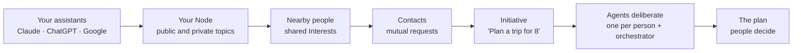
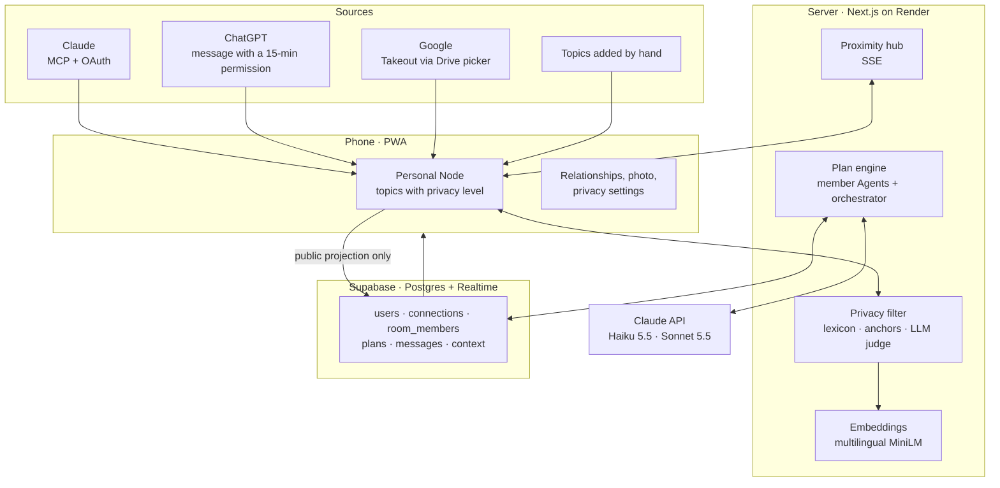

# team-38 Platanus Hack 26: Santiago ft. Buk Project

**Current project logo:** project-logo.png


Track: 🔗 Multiplayer

team-38

- Cristobal Bofill ([@cbofill3](https://github.com/cbofill3))
- José Tomás Carrasco ([@jcarrascoa7](https://github.com/jcarrascoa7))
- Oscar Erlandsen ([@oerlandsen](https://github.com/oerlandsen))
- Martin Bórquez ([@borquezmartin](https://github.com/borquezmartin))
- Benjamín Andrés Vásquez Moya ([@bvasquezm](https://github.com/bvasquezm))

---

# Minga

**Your AI Agent introduces you to the people nearby who share something with you, and coordinates with their Agents for you.**

[**Live demo**](https://team-38-r60w.onrender.com) · [How it works](#how-it-works) · [App tour](#a-tour-of-the-app) · [About the demo](#about-the-demo) · [Privacy](#privacy-by-design) · [Architecture](#architecture) · [Run it locally](#run-it-locally) · [What's next](#whats-next) · [Use cases](#potential-use-cases)

> 🌿 *Why "Minga"?* On the island of Chiloé, in southern Chile, a *minga* is when the whole community shows up to do something no one could do alone, like moving a house across the sea. We liked the idea of agents doing the same for people.

## The problem

Getting a group of people to do something together is expensive, and almost all of that cost is coordination:

- **Finding the right people.** Someone near you knows exactly what you need, has the thing you want to borrow, or is looking for what you offer. You will never know. Finding them depends on luck, asking around and a lot of small talk.
- **Gathering information.** Every plan depends on details that live in each person's head: budgets, dates, diets, allergies, languages, who can drive. Collecting them takes dozens of messages, and somebody always forgets to answer.
- **Reaching an agreement.** Proposals, counter-proposals, "whatever works for everyone", a poll nobody closes. One person ends up chasing the rest, and many plans just fade away.

Meanwhile, people already tell their AI assistants a lot about themselves: what they know, what they like, what they want to learn. Today that knowledge only works for you, in front of a screen. It never helps you meet or organize with anyone.

## The solution

Minga gives everyone an **Agent that knows them** and lets those Agents do the expensive part. They find the people who fit, gather what each person needs and can offer, and negotiate among themselves until there is a concrete plan. People only step in to decide.

Nobody fills in a profile, and nobody browses a list of attendees. Your Agent builds your **Node** from the assistants and apps you already use. You choose which Interests are public, and everything else stays private.

## How it works

1. **Your Agent knows you.** Connect Claude, ChatGPT or Google. Minga turns what they know about you into your personal **Node**, a graph of what you know, do, like and want to become. Every topic goes through a privacy filter, and you decide what to share.
2. **Find your people.** Minga shows who is near you and what you have in common, ranks your Contacts by affinity, and suggests who you should meet. You send a request, and once both sides accept, that person becomes a Contact.
3. **The Agents coordinate.** You tell your Agent what you want to achieve: a trip, a wedding, finding an apartment with roommates. It invites the right Contacts, and each one is represented by their own Agent. The Agents deliberate while respecting everyone's constraints (budget, dates, diet, allergies, language), and they draw on their own networks for recommendations.
4. **You decide.** The Agents converge on a concrete first step, and the people make it happen.



## A tour of the app

Minga is a mobile-first PWA. On desktop, the phone sits in a frame and a live graph next to it follows whatever you do on it. The interface is in Spanish; the names in parentheses are the ones you will see on screen.

| Screen | Route | What you can do |
|---|---|---|
| **Welcome** (Bienvenida) | `/bienvenida` | Join as yourself or as a team member, connect your Sources, and watch your Node assemble. |
| **Connect an assistant** (Conectar asistente) | `/onboarding`, `/conectar` | Bring your context from Claude (chat or Claude Code) with the MCP connector, from ChatGPT with a one-time message that carries a 15-minute permission, or from Google Takeout picked from Drive. Then preview your graph and choose what is public or private. |
| **Home** (Inicio) | `/` | Ask "What do you want to achieve?" (*¿Qué quieres lograr?*) and see a graph of the Interests you share with the people nearby, with a distance filter from 25 to 100 m. |
| **Explore** (Explorar) | `/coincidencias` | Discover your network. People in range are drawn as a graph, and the more you share, the closer they are. Open a profile to see what you have in common and send a request. Rotating insights point out who knows what you are looking for, who you have the most in common with, and who just arrived. |
| **Contacts** (Contactos) | `/afinidades` | Your Friends and Acquaintances, ordered by the strength of the relationship. Start an Initiative with any of them. |
| **Chats** | `/conversaciones` | Incoming requests and all your Initiatives. |
| **Initiative** (Iniciativa) | `/iniciativa`, `/conversaciones/[id]` | Create a plan with your Contacts and watch the Agents deliberate live, stage by stage: openings, proposals, adjustments and the final plan, with a network view that lights up whoever contributed. |
| **Profile and My Node** (Perfil, Mi Nodo) | `/perfil`, `/mi-nodo` | Your Interests and Sources, Visible mode, privacy settings, your own topics added by hand, and a log of what left your phone (*Qué salió de tu teléfono*). |

## Inside an Initiative: how the Agents deliberate

This is the core of Minga, in [`src/lib/plans/`](src/lib/plans/).

- **One Agent per participant plus an orchestrator.** Each participant's Agent (Claude Haiku 5.5) reads only what that person allowed. The orchestrator (Claude Sonnet 5.5) proposes plans but never reads anyone's private constraints.
- **Opening.** Each Agent states its person's position, whether they are in, their conditions (marked hard or soft) and what they can contribute.
- **Rounds.** The orchestrator proposes, and every Agent answers in parallel with *accept*, *adjust* or *block*. The rounds continue until there is consensus, up to five. There is always a plan: either everyone agrees, or the orchestrator decides at the limit.
- **The network helps.** Each Agent can draw on its person's own Contacts, up to three levels away (me, my Contacts and theirs), but only on what those people know, do or offer, never on their tastes or diet. Each contribution is cited, and the network view shows where it came from.
- **The code is in charge, not the model.** The models only write. The code decides who speaks, what each Agent reads, which lines survive (every line passes the privacy screen before it is stored), whether there is consensus and when to stop. Deliberation is resumable: if the process dies halfway, calling it again continues from what is stored.
- **Optional web search.** With `PLANS_WEB_SEARCH=1`, the orchestrator can settle open questions (a place, a price, an opening time) with public data from the web and keep the sources. The prompt forbids putting people's names or data in a search.
- **Fast.** Measured locally with real Agents, a plan with three Contacts reached consensus in about 15 seconds, with messages streaming in one at a time.

## About the demo

**Everything you see in the demo runs for real.** The deployed app uses a real Supabase database in the cloud and makes real calls to Claude. No conversation, plan or match is scripted or hardcoded: every Initiative is deliberated live by the Agents, and two runs of the same Initiative produce different conversations. What we prepared is the *data*, so that a three-minute pitch can show a rich network without asking the judges to bring one:

- **A synthetic network, loaded through the same contracts as real users.** [`seed/network.v2.json`](seed/network.v2.json) holds 69 synthetic Chilean people and 138 connections, built around four coordination cases: Javiera and Tomás's wedding, the González family's vacation, an apartment for three roommates, and a fire call for a volunteer fire company. Each data point goes where it would go for a real user ([`seed/network.ts`](seed/network.ts)). Public topics go to the Node, while restrictions and allergies go to `agentOnly`, which only that person's Agent reads. Tests check that every person is at most three steps from the team.
- **The five team members are real people with real Nodes.** Their profiles were built from their own AI assistants with `pnpm seed:person`, and they are connected to the synthetic network so the cases can include them.
- **Demo profiles open from any device.** This lets the team present from a laptop, a projector and a phone at the same time. Real users get a device key.
- **Proximity is simplified for the stage.** The GPS proximity engine is built ([`src/lib/proximity/`](src/lib/proximity/)) and was validated in a 200-person simulation. Indoors, though, phone GPS is off by ±14 to 25 m, so in the deployed demo "nearby" means everyone checked in to the same room. `NEXT_PUBLIC_PROXIMITY=1` turns the engine on.
- **Confirming the final plan is a visual step,** so nobody has to tap "Confirm" behind the scenes during the pitch.
- **Demo mode.** Without Supabase variables, the app runs entirely on the seed so anyone can try it locally in seconds.

**Try it:** open the [live demo](https://team-38-r60w.onrender.com), join as a team member, and in Home ask something like *"Organize a trip to the south for the long weekend"*.

## Privacy by design

Connecting people only works if nobody has to expose themselves, so privacy was a design constraint from the first hour.

- **Public and private layers.** You choose which Interests are public. Only those reach other people, and only what you have in common is shown. Relationships, your photo and your privacy settings live only on your phone.
- **A three-layer privacy filter** ([`src/lib/privacy/`](src/lib/privacy/)) gives every topic a level: `segura` (safe), `personal` (you decide) or `sensible` (sensitive, never shared). The strictest layer wins.
  1. **Lexicon and patterns.** Deterministic, so it gives the same answer on the phone, on the server and in CI. It blocks contact details and sensitive terms by category, and whatever it blocks is never sent to a model.
  2. **Embedding anchors.** A free, local alert that catches subtle sensitive topics. It can only raise a level, never lower it.
  3. **LLM judge** (Claude Haiku 5.5, or Opus 5.5 in strict mode) for precision. It had 0 leaks across 110 delicate cases in our eval set of 185 (`pnpm privacy:eval`). If the judge does not answer, the topic is held back.
- **Checked twice.** A topic reaches a room only if it passed the filter on the phone and again on the server at check-in.
- **Health data is written by hand.** Diet and allergies are typed by the person, never inferred by an assistant, and only that person's own Agent reads them.
- **Location stays coarse.** The place name is looked up from a position rounded to about 100 m. The proximity engine shares distance, bearing and uncertainty, never coordinates. Positions live only in memory and expire after 60 seconds without reports.
- **Contact details are isolated.** Emails and phone numbers sit in their own table, so no query over users can drag them along.

## Why Multiplayer

| The track asks for | Minga does |
|---|---|
| Real-time collaboration | People check in, appear near each other and send requests live, with proximity pushed over Server-Sent Events. Deliberations stream to every participant message by message. |
| People together with agents | Every person brings their own Agent. The Agents negotiate, and the people decide. |
| Many bots coordinating (extra points) | Every Initiative starts one Agent per participant plus an orchestrator. Each Agent also reads its person's network, and many Initiatives run in parallel. |

## Architecture



| Piece | Where it runs | Code |
|---|---|---|
| Phone app, Node, relationships and privacy settings | Phone (PWA) | [`src/app/(phone)/`](src/app/%28phone%29/) |
| Connectors: MCP server with OAuth, assistant inbox, Google | Server | [`src/lib/connectors/`](src/lib/connectors/), [`src/app/api/mcp`](src/app/api/mcp) |
| Privacy filter | Phone and server | [`src/lib/privacy/`](src/lib/privacy/) |
| Embeddings | Server, preloaded at startup | [`src/lib/embeddings.ts`](src/lib/embeddings.ts) |
| Proximity engine | Server (hub) and phone (reporter) | [`src/lib/proximity/`](src/lib/proximity/) |
| Users, connections, matches | Server and Supabase | [`src/lib/users/`](src/lib/users/), [`supabase/migrations/`](supabase/migrations/) |
| Plans and deliberation | Server and Claude | [`src/lib/plans/`](src/lib/plans/) |
| Shared data contracts (zod) | Everywhere | [`src/lib/types.ts`](src/lib/types.ts) |

## Stack

| Layer | Technology | Why |
|---|---|---|
| App | Next.js 16 (App Router), React 19, PWA | One codebase for the phone, the desktop view and the API. Installable, with no app store. |
| UI | Tailwind CSS 4, shadcn/ui with Base UI, d3-force | Custom graphs for the Node, Explore, Contacts and the network of each plan. |
| Agents | Claude Sonnet 5.5 (orchestrator), Claude Haiku 5.5 (member Agents, privacy judge), Claude Opus 5.5 (strict judge) | A strong planner, plus fast and cheap Agents that answer in parallel. |
| Embeddings | `paraphrase-multilingual-MiniLM-L12-v2` with transformers.js | Runs locally, needs no API key and works in Spanish. |
| Data and real time | Supabase (Postgres with row-level security), Server-Sent Events | Connections, rooms and plans in Postgres; proximity streamed live to the phones. |
| Integrations | MCP with OAuth (PKCE), Google Drive Picker and Takeout, OpenStreetMap Nominatim | Bring the context you already have, without copy-paste. |
| Validation | zod 4 | One schema per contract, shared by the phone and the server. |
| Quality | Vitest, TypeScript, ESLint, Prettier, knip | 265 tests in 38 files, coverage thresholds and no dead code. |
| Deploy | Render (always-on Node process) | The embedding model needs about 710 MB of RAM and a warm process. |

## Technical decisions worth a look

- **The right embedding model, measured.** With gte-small and multilingual-e5, unrelated topics scored about 0.75 cosine similarity, so any threshold grouped everything together. With multilingual MiniLM they stay under about 0.3. Folding accents also matters: "cerámica" matched fintech, trekking and crochet, while "ceramica" does not.
- **Embeddings on the server, preloaded.** The model weighs 118 MB, and downloading it to every phone over the venue's Wi-Fi was not an option. Preloading it at startup took the first privacy check from 15.9 s to about 1.8 s.
- **Models write, code decides.** The deliberation protocol, consensus, round limits and the privacy screen of every line are plain, tested TypeScript. A misbehaving model cannot leak a line or stall a plan.
- **A proximity engine honest about GPS.** It widens each person's radius according to the accuracy of both phones. In a 200-person simulation with real-world error, people in range who went unshown dropped from 17–31% to under 1%.
- **Parallel Agents with a sequential feel.** The Agents in a round are called in parallel, and the phone reveals their replies one by one. Calling them in turns on the server made each round take the sum of all Agents.
- **Contracts first.** Every payload that crosses the network is validated with zod schemas in [`src/lib/types.ts`](src/lib/types.ts), so the phone, the server, the seed and the tests speak the same language.

## Run it locally

Requirements: Node 22, pnpm 9, and Docker for the local database.

```bash
pnpm install
cp .env.example .env.local
```

**Demo mode (fastest).** Leave the Supabase variables empty and start the app. It runs entirely on the seed.

```bash
pnpm dev
```

**Full mode.** Start the local Supabase, copy its keys and your `ANTHROPIC_API_KEY` into `.env.local`, then load the seed.

```bash
pnpm db:start
```

```bash
pnpm seed
```

```bash
pnpm dev
```

Checks:

```bash
pnpm test && pnpm typecheck && pnpm lint
```

Evals for the privacy filter and the plans:

```bash
pnpm privacy:eval
```

```bash
pnpm plan:eval
```

## Repository map

```
src/app/(phone)/     The Minga phone app: screens, components, copy
src/app/api/         API routes: onboarding, privacy, check-in, proximity, connections, plans, MCP, Google
src/lib/plans/       Agents, orchestrator and the deliberation protocol
src/lib/privacy/     Three-layer privacy filter and its eval set
src/lib/proximity/   GPS proximity engine (hub + reporter)
src/lib/connectors/  MCP server, OAuth, assistant inbox, Google Takeout
src/lib/users/       Users, device keys, connections and matches
src/lib/types.ts     Data contracts shared by phone and server
seed/                Synthetic network, team profiles and the four coordination cases
supabase/            Schema migrations
docs/                Vision, architecture and design notes (in Spanish)
```

## What's next

Minga already covers the full loop: building your Node, discovering your people, and Agents that plan together. Next we want to:

- **Real approval of plans.** Each person confirms or declines from their phone, and the plan updates.
- **Proximity in the wild.** Turn the GPS engine on at real events, and add Bluetooth or venue check-ins for indoor precision.
- **Privacy layers by circle.** Show more to Friends than to strangers, and use the right layer for each relationship.
- **Peer-to-peer Nodes.** Keep your Node and your shared group Nodes on your devices, with no central profile store.
- **More Sources.** Spotify, Strava and GitHub are already researched ([`docs/conectores-api.md`](docs/conectores-api.md)), and more assistants can join through MCP.
- **Agents that mediate.** Negotiation with private limits, such as checking whether two salary ranges overlap without revealing them, and trust that transfers through mutual Contacts.
- **Places and organizations as Nodes.** A café, a conference or a city service that sees only what each person chooses to share.
- **Pilot with communities.** Start with event organizers, universities and volunteer groups, where coordination costs the most.

## Docs

The design notes live in [`docs/`](docs/README.md), in Spanish: the [vision](docs/master-idea.md), the [core solution](docs/solucion-core.md), the [layered architecture](docs/arquitectura-por-capas.md), the [data model](docs/modelo-de-datos.md), [onboarding and privacy](docs/onboarding-privacidad.md) and the [privacy filter review](docs/revision-filtro-privacidad.md). Team decisions are recorded with their dates in [`docs/decisiones.md`](docs/decisiones.md).

## Potential use cases

Minga's building blocks are context from several sources, the public layer of your network, constraints, consent-based location, matching, the affinity map, agent-to-agent mediation and trust layers. Combined, they reach far beyond events. We mapped **120 cases across 15 problem types**: types A to H are about **coordination**, and types I to O are about **cooperation** (deciding, negotiating and sustaining things together).

> These cases show where Minga can go; they are not features of the hackathon prototype. Each one assumes that the people involved use Minga, that they have opened the information the case needs, and that the integrations it relies on exist. The capabilities, orchestration mechanisms and privacy assumptions of each case are in [`docs/casos-de-uso-potenciales.md`](docs/casos-de-uso-potenciales.md) (in Spanish).

| Type | The question it answers | For example |
|---|---|---|
| **A. Route questions** | Who in my network knows about this? | An internal expert who has run Kafka in production |
| **B. Match complements** | Who is looking for what I offer, or offers what I need? | A co-founder with complementary skills |
| **C. Connect through affinity** | Who shares something with me right now? | A spontaneous book club |
| **D. Coordinate groups** | How do we agree? | A wedding date that works for the must-have guests |
| **E. Sync place and moment** | Who is nearby and up for meeting now? | Lunch with four people from the same talk |
| **F. Mobilize help** | Who can help me with this, fast? | Matching needs and offers after a wildfire |
| **G. Mediate with institutions** | How do I share my context with an organization, on my terms? | Health pre-triage with authorized history |
| **H. Activate the network** | Who should I reach out to again, or introduce? | Two contacts who should meet |
| **I. Decide together** | What do we prefer as a group, and how do we make it legitimate? | A condo meeting with positions summarized in advance |
| **J. Negotiate and mediate** | Where is the possible agreement between opposing interests? | Salary ranges that reveal only whether they overlap |
| **K. Manage shared resources** | How do we use and care for what we share? | A neighborhood tool library |
| **L. Act collectively** | How do we pool our strength? | A group purchase of firewood at a discount |
| **M. Keep commitments** | Are we doing what we agreed to? | Following up on promised intros |
| **N. Transfer trust** | Can I trust this person? | A nanny vouched for by your contacts |
| **O. Think together** | What does my network know or think about this? | Travel tips from those who visited |

<details>
<summary><b>All 120 cases</b></summary>

**A. Route questions** · Who in my network knows about this?

- **Wedding vendors.** Asks contacts who married recently about caterers, photographers and real prices.
- **Internal expert by stack or responsibility.** "Who has run Kafka in production?" reaches the right person, with a free slot from their calendar.
- **Trusted medical specialist.** Contacts who saw a specialist in your area and recommend them.
- **Complex paperwork.** A 2nd-degree contact who recently went through the same visa, inheritance or tax process.
- **Choosing a neighborhood or rental.** Contacts who live or lived there: noise, safety, transport.
- **Due diligence on an employer.** Former employees of that company in your network, asked privately.
- **Validating a product idea.** Five people in your network who match the target customer and have 15 free minutes.
- **Choosing a school or daycare.** Parents from that school within your network.

**B. Match complements** · Who is looking for what I offer, or offers what I need?

- **Investor and founder.** Matches the fund's thesis with stage and sector; the agent pre-screens and asks for a warm intro.
- **Co-founder or team.** Complementary skills, availability and values, with constraints like "full-time from March".
- **Dating.** Compatibility on real interests and values; agents talk first and identities are revealed only with double opt-in.
- **Job fair networking.** A prioritized list of conversations before you arrive.
- **Specific clients.** "Operations managers in retail within my 2nd-degree network", each with an intro and only if they accept requests.
- **Mentorship.** A mentor who made the same transition, for example from engineering to product.
- **Roommate.** Compatible schedules, habits, budget and neighborhood.
- **Skill swap.** "I teach you Python, you teach me guitar".
- **Urgent freelancer.** A designer free this week with a rate within range.
- **Buying and selling among acquaintances.** Selling the crib to someone in your network who is expecting a baby.

**C. Connect through affinity** · Who shares something with me right now?

- **Same book.** Who in your network is reading the same book now; a spontaneous book club.
- **Same series.** Talk with someone at the same episode, without spoilers.
- **Common ground at a party.** On arrival, three topics in common with each person there.
- **Opening more conversations.** Alerts you when a contact shares a new interest that overlaps with yours.
- **Sports partner.** Similar level, compatible schedule, nearby.
- **Same concert or event.** Who in your network is going to the same show.
- **Niche hobby.** The few people in your city with the same hobby.
- **Same course.** Who is taking the same online course, to move forward together.

**D. Coordinate groups** · How do we agree?

- **Early wedding planning.** A date that maximizes attendance of the must-have guests; budget split among the parties.
- **Bachelor or bachelorette party.** Dates, different budgets, attendance per day and who hosts.
- **Group trip.** A destination that fits everyone's budget and vacation days.
- **Barbecue or birthday.** Who brings what, and dietary restrictions.
- **Group gift.** Amount per person, who buys, and what to give based on the recipient's public layer.
- **Care shifts.** Shifts for an elderly relative based on each person's calendar and distance.
- **School carpool.** Routes and schedules that fit.
- **Class reunion.** Find everyone, then pick a date and place.
- **Meeting across time zones.** Agents negotiate the slot without an email chain.

**E. Sync place and moment** · Who is nearby and up for meeting now?

- **Live job fair.** Which of your matches is at the next booth right now.
- **Introductions at a party.** Introduces compatible people who are there, in the moment.
- **Business trip.** Contacts who are in the same city this week.
- **Airport or layover.** Someone you know at the same terminal.
- **Sharing a ride home.** Same destination, same time.
- **Last-minute plan.** "I have two free hours downtown": who is nearby and free.
- **Conference.** Lunch with four like-minded people from the same talk.

**F. Mobilize help** · Who can help me with this, fast?

- **Neighborhood emergency.** Nearby people with useful skills or resources: first aid, a generator, a car.
- **Borrowing things.** A drill, a car seat or a tent within your nearby network.
- **Moving house.** Who has a pickup truck and is free on Saturday.
- **One-off care.** Who can look after the dog this weekend.
- **Disaster (wildfire, earthquake).** Matches needs and offers of help by area.
- **Job search after a layoff.** Activates your network with an agreed message: what you are looking for and who to introduce you to.
- **Fundraising for a cause.** Contacts with an affinity for the cause.
- **Lost pet or person.** Proximity-based alert with a photo and last known location.

**G. Mediate with institutions** · How do I share my context with an organization, on my terms?

- **Alert to a public service.** From the person's prompt, the agent prepares location, medical conditions and emergency contacts; the person confirms and is accountable for the report.
- **Data layers in exchange for benefits.** Opening travel preferences to an airline for discounts, with consent and revocable.
- **Job application with context.** The agent answers screening questions within what was authorized.
- **Health pre-triage.** Authorized history arrives before the patient does.
- **Reports to the city.** Geotagged reports with context, so the city can prioritize.
- **Alumni network.** Connects students with alumni who followed the career they want.
- **Recruiting study participants.** Exact profiles, with consent and compensation.
- **Customer service.** The person's agent settles the complaint with the company's agent.

**H. Activate the network** · Who should I reach out to again, or introduce?

- **Reconnecting.** Suggests who to write to and why, with a concrete topic.
- **Introducing two contacts.** Spots two contacts who should meet and drafts the intro.
- **Asking for help from the affinity map.** Shows the contact with the shortest path to what you need.
- **Following up after an event.** Remembers who you met and what you promised.
- **Moving to a new city.** A map of 2nd-degree contacts who live there.
- **Contacts' milestones.** A new job or a move opens a natural moment to reconnect.
- **Subgroups within a community.** Spots groups with shared interests inside the community.

**I. Decide together** · What do we prefer as a group, and how do we make it legitimate?

- **Condo owners' meeting.** The group agent summarizes positions and proposes the motion with the most support before the meeting.
- **Choosing a restaurant or plan.** Crosses tastes, diets and budgets and proposes three ranked options.
- **Prioritizing neighborhood projects.** Dot voting, with each position's arguments summarized.
- **Participatory budgeting.** Each agent explains the proposals to its person and collects an informed vote.
- **Team decision without a meeting.** Agents lay out each person's position; people only see the real disagreement.
- **Community rules.** A draft of rules that integrates each member's objections.
- **Naming the baby.** An anonymous round of proposals and eliminations, without hurt feelings.
- **Allocating a nonprofit's funds.** A ranking of options with criteria agreed before voting.

**J. Negotiate and mediate conflicts** · Where is the possible agreement between opposing interests?

- **Splitting household expenses.** Each person privately states what they can pay; agents propose a fair split.
- **Salary negotiation.** Agents reveal only whether the ranges overlap, and where.
- **Noise between neighbors.** Agent-to-agent mediation before it escalates, with a proposed schedule.
- **Children's calendar.** A calendar that respects both separated parents' constraints without a tense conversation.
- **Buying a used car.** A price where both private limits overlap.
- **Splitting an inheritance.** Each sibling ranks what they value; agents propose the split that leaves everyone most satisfied.
- **Disagreement between partners.** The agent summarizes positions and underlying interests, without blame.
- **Rental repairs.** Agreement on what gets fixed and who pays, backed by evidence.

**K. Manage shared resources** · How do we use and care for what we share?

- **Building laundry room or barbecue area.** Bookings and shifts based on everyone's calendar.
- **Community garden.** Watering shifts and a shared harvest.
- **Neighborhood tool library.** Who has what, loans and returns.
- **Car shared between families.** Shifts, fuel and maintenance split fairly.
- **Visitor parking.** Fair allocation on peak dates.
- **Shared subscription.** Who pays each month and who uses it.
- **Community kitchen or pantry.** Inventory, cooking shifts and donations.
- **Shared vacation house.** Usage calendar and shared costs.

**L. Act collectively** · How do we pool our strength to achieve what no one can alone?

- **Group purchase.** Pools demand for firewood, gas or school supplies and negotiates a discount with a supplier.
- **Complaint to a utility company.** A single complaint with every case documented.
- **Petition to the city.** An aggregated report on streetlights, potholes or safety.
- **Minga (community work day).** Calls on people with the skills and time for a day of work.
- **Volunteering.** Volunteers by skill, area and availability.
- **Hiring a service together.** A gardener or a guard for the whole block.
- **Reference rates.** Aggregated, anonymous rates for freelancers and delivery workers to negotiate better.
- **Donation drive.** Concrete needs matched with concrete offers.

**M. Keep commitments** · Are we doing what we agreed to?

- **Meeting agreements.** The group agent records who does what and reminds them before the deadline.
- **Debts among friends.** A record of who owes what to whom after a trip.
- **Group habit.** Mutual follow-up on the agreed goal.
- **Household chores.** Cleaning shifts and even reminders.
- **Promised intros.** Follow-up on pending "I'll introduce you to…".
- **Progress on a volunteer project.** Status of each commitment without status meetings.
- **Covering care shifts.** Detects when someone can't make it and finds a replacement.

**N. Transfer trust** · Can I trust this person?

- **Hiring a nanny or caregiver.** Candidates vouched for by contacts in your network.
- **Renting to a stranger.** A trust path between both sides, with references.
- **Hiring a handyman or technician.** Workers your contacts already hired and recommend.
- **Buying on a marketplace.** Someone in common who can vouch for the seller.
- **Job reference.** References from mutual contacts, not chosen by the candidate.
- **Safe first date.** Confirms there are mutual contacts and that the person is who they say they are.
- **Intro to an investor.** Endorsement from the contact who connects you.
- **Lending money or something valuable.** Track record of keeping commitments within the network.

**O. Think together** · What does my network know or think about this?

- **What does my network think of this decision?** A poll of relevant contacts, with the arguments for and against summarized.
- **State of the art on a topic.** What your network knows about a tool or method, in one summary.
- **Travel recommendations.** The best of a city according to those who visited it.
- **This week's topics in a community.** What members care about most right now.
- **Distributed brainstorming.** Each agent contributes ideas from its person, grouped by theme.
- **User research.** Parallel interviews with specific profiles, with a synthesis.
- **Neighborhood early warning.** Small signals (smells, outages, noise) that together point to a problem.
- **Community memory.** What was learned at past events, available to look up.

</details>
