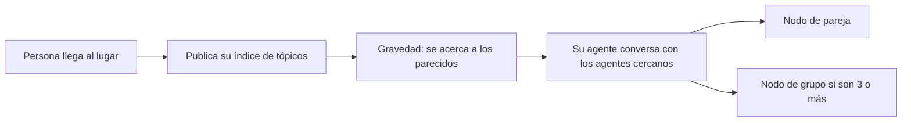

# Modelo técnico

*Modelo técnico de la idea — piezas, formato de los .md, similitud con embeddings por tópico, reglas de gravedad y de nodos de pareja y de grupo, y resultados de una simulación con datos de prueba (no validados).*

Nodos agénticos por persona que se conectan por cercanía física. Cada persona lleva un agente con su conocimiento; al compartir un lugar, los agentes encuentran lo que tienen en común y dejan nodos compartidos que representan la conexión.

> **Estado: reemplazado en buena parte por [arquitectura-por-capas](../arquitectura-por-capas.md).** Ya no valen la gravedad por pares, los nodos de pareja ni el nodo de grupo como intersección estricta: la sala agrupa todos los tópicos en temas y arma mesas por cobertura de roles. Siguen vigentes la representación (un embedding por tópico), el umbral de coseno 0,60 y la profundidad de 1 a 3. Se conserva como antecedente. El propósito, sin detalle técnico, está en [solucion-core](../solucion-core.md).

Este documento usa otros nombres para las mismas cosas:

| Aquí | En el documento maestro | En la arquitectura (hack) |
|---|---|---|
| Nodo personal (`.md`) | Grafo personal | Nodo personal (`PersonalNode`) |
| Índice (lo que se publica) | Capa pública | Proyección pública (`PublicProjection`) |
| Nodo de pareja | Nodo de relación | — (no hay pares) |
| Nodo de grupo | Nodo de grupo | Mesa → nodo de grupo (`GroupNode`) |

## Las cinco piezas

| Pieza | Qué es | Quién la ve |
|---|---|---|
| **Nodo personal** | Un `.md` con el conocimiento de la persona + su agente | Solo su agente |
| **Índice** | Los tópicos públicos del `.md`: nombre, profundidad y un embedding por tópico | El servicio que calcula la gravedad |
| **Gravedad** | Atracción entre dos nodos según similitud | Todos (es la forma del grafo) |
| **Nodo de pareja** | `.md` compartido entre dos personas | Sus dos agentes |
| **Nodo de grupo** | `.md` compartido entre 3 o más personas, nombrado por tópico | Los agentes de sus miembros |

Regla que sostiene todo: **el `.md` personal nunca se lee desde afuera. El agente es la única puerta.**

## Flujo



1. **Llegada.** La persona entra al lugar físico y su nodo publica solo el índice.
2. **Gravedad.** Se calcula la similitud contra los presentes. Decide con quién vale la pena conversar.
3. **Conversación.** Los agentes intercambian mensajes: uno pregunta (extraer) o propone (mandar), el otro responde filtrando según las reglas de su dueño.
4. **Nodo de pareja.** Lo que ambos autorizaron queda en un `.md` común. Es la memoria de esa relación.
5. **Nodo de grupo.** Si 3 o más comparten un vínculo fuerte, se crea un nodo por tópico al que todos se conectan.

## Modelo de datos

**Nodo personal** (`ana.md`). Tópicos con profundidad de 1 a 3, más intención.

```md
# ana.md

## Tópicos
- open-banking · 3
- fintech · 3
- running · 2

## Busca
- inversión semilla

## Ofrece
- experiencia en pagos
```

**Nodo de pareja** (`ana+beto.md`).

```md
# ana+beto.md

## En común
- open-banking · Ana 3 · Beto 2
- fintech · Ana 3 · Beto 3
- pagos ≈ riesgo (0.61) · Ana 3 · Beto 3

## Busca y ofrece
- Ana busca: inversión semilla
- Beto ofrece: asesoría regulatoria

## Siguiente paso
- Conversar sobre open-banking
```

Una línea con `≈` es un cruce por significado: dos tópicos distintos que calzan por embedding, con su coseno entre paréntesis.

**Nodo de grupo** (`grupo-open-banking.md`).

```md
# grupo-open-banking.md

## Miembros
- Ana, Beto, Mora

## En común (todos)
- open-banking · mínimo 2
- fintech · mínimo 2

## Buscan
- Ana: inversión semilla

## Ofrecen
- Mora: conocimiento regulatorio
```

## Reglas

**Representación:** un embedding por tópico, no uno por persona. Un solo vector por persona diría cuánto se parecen dos nodos pero no en qué, y lo valioso es poder nombrar lo común.

**Calce entre tópicos:** dos tópicos calzan si el coseno de sus embeddings supera un umbral. Tópicos idénticos tienen coseno 1.

**Similitud entre dos personas** (define la gravedad). Cada tópico de A busca su mejor par en B:

```
calce(k, B)     = tópico t de B con mayor coseno(k, t), solo si coseno ≥ umbral
aporte(k)       = coseno(k, t) × min(prof_A(k), prof_B(t)) / frecuencia(k)
similitud(A, B) = promedio de [ Σ aportes de A hacia B ,  Σ aportes de B hacia A ]
```

- `coseno`: un calce exacto pesa más que uno aproximado.
- `min(prof)`: cuenta lo que sabe el que menos sabe.
- `frecuencia`: cuántas personas tienen el tópico. Lo raro acerca más que lo masivo.
- Con umbral 1 la fórmula se reduce al match exacto de tópicos.

**Gravedad:** la similitud es la fuerza de atracción entre dos nodos. No es lo único que los mueve: todos los nodos se repelen para no amontonarse, un par que ya tiene nodo de pareja se atrae 1,5 veces más, y cada nodo de grupo tira de sus miembros.

**Match de intención:** `busca` de uno contra `ofrece` del otro. Es complementariedad, no similitud: no sale de comparar embeddings y hoy no influye en la gravedad, solo en lo que conversan los agentes.

**Nodo de pareja:** se crea cuando dos agentes cierran una conversación. Guarda cada calce, marcando con `≈` los que son por significado.

**Nodo de grupo.** Al llegar una persona, por cada tópico suyo:

- **Candidatos:** los presentes que tienen algún tópico que calce con ese.
- **Comunes:** los tópicos de quien llega para los que todos los candidatos tienen un calce.
- **Fuerza:** suma, sobre los comunes, del menor `coseno × min(prof)` entre los miembros.
- Nace si hay 3 o más candidatos y la fuerza es 4 o más.
- No se crea si ya existe un grupo que difiere en a lo más una persona.
- Se nombra por el tópico común más fuerte.
- Alguien nuevo se une solo si tiene calce para todos los tópicos comunes del grupo, para que no se diluya.
- Nunca se crea un nodo por combinación de personas: el grupo es el tópico.

**Límite de conversaciones:** cada agente conversa con sus vecinos más cercanos, no con toda la sala.

## Privacidad

- Cada tópico del `.md` tiene una sola decisión: se publica en el índice o no.
- El agente responde con resúmenes, nunca entrega el archivo.
- Los nodos compartidos contienen solo lo que cada parte autorizó.
- Un tercero no ve los nodos de pareja ajenos.

## Valores iniciales, no validados

Salieron de una simulación con 14 personas de prueba. Hay que ajustarlos con datos reales.

| Parámetro | Valor |
|---|---|
| Profundidad por tópico | 1 a 3 |
| Umbral de calce entre tópicos (coseno) | 0,60 |
| Umbral de nodo de grupo | fuerza ≥ 4 |
| Tamaño mínimo de grupo | 3 |
| Refuerzo de gravedad con nodo de pareja | × 1,5 |

**Los embeddings de la simulación no vienen de un modelo.** Son vectores de 8 dimensiones armados a mano por tópico. Sirven para ver la mecánica; los números de abajo no dicen nada sobre qué tópicos se parecen de verdad.

Efecto del umbral de calce en la simulación (91 parejas posibles):

| Umbral | Parejas conectadas | Solo por significado | Grupos |
|---|---|---|---|
| 1,00 (solo idénticos) | 75 | 0 | 3 |
| 0,60 | 89 | 14 | 4 |
| 0,40 | 91 | 16 | 3 |

Observaciones de la simulación, por validar con embeddings reales:

- **El umbral es la decisión de producto.** Muy alto pierde conexiones razonables; muy bajo conecta a todos con todos y la gravedad deja de separar.
- **Los grupos se inflan antes que las parejas.** Con 0,60 un grupo pasó de 3 a 6 personas porque tres tópicos cercanos quedaron como equivalentes. Idea a considerar: un umbral más estricto para grupos que para parejas.
- **El resultado depende del orden de llegada.** Los grupos se evalúan cuando alguien entra, así que otro orden puede dar grupos distintos. Idea a considerar: recalcular cada cierto tiempo.

## Fuera del core, por decidir

- **Origen del `.md`:** se extraerá del Claude o ChatGPT personal de cada uno. Al principio va mockeado a mano. Propuesta de conector en [mcp-ingestion](mcp-ingestion.md).
- **Detección de cercanía:** QR, BLE, geocerca o wifi del lugar.
- **Embeddings reales:** el modelo se eligió el 21-11 (ver [decisiones](../decisiones.md)). Se calcula un vector por tópico una sola vez y viaja en la proyección pública.
- **Salida de personas** y disolución de grupos.
- **Borrado** de un nodo compartido cuando una parte se retira.
- **Comercios:** un negocio como nodo que ve demanda agregada y le habla al agente, no a la persona.
