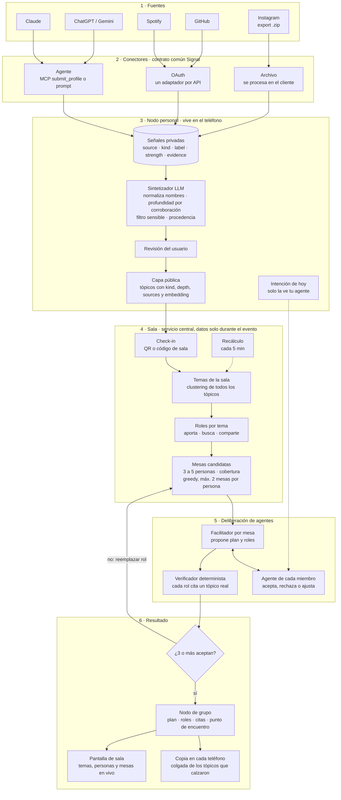

# Arquitectura por capas

*Diseño de la solución en 6 capas — nodo personal multi-fuente (Claude, ChatGPT, Spotify, GitHub, Instagram), sala que arma mesas de 3 o más personas por roles y agentes que deliberan el plan. Solo capa pública.*

El **cómo** de la idea de [master-idea](master-idea.md), que tiene la visión completa. Para el hack mandan las decisiones de esta nota (solo capa pública, 3 o más personas) y las de `CLAUDE.md`. El orden de construcción está en [plan-de-construccion](plan-de-construccion.md).

> **Estado (21-11-2026):** solo lo marcado **Decidido** es acuerdo del equipo. Lo marcado **Propuesta** es el supuesto con el que se arma el plan: se puede construir sobre él, pero hay que confirmarlo antes de cambiarlo o de presentarlo como decidido.

En lo que se contradiga, esta nota reemplaza a [modelo-tecnico](modelo-tecnico.md) (gravedad por pares, grupo como intersección estricta), al `public: [...]` de [mcp-ingestion](mcp-ingestion.md) y, para el hack, a lo que [master-idea](master-idea.md) deja como visión (capas por círculo, peer-to-peer, nodos de pareja).

## Decisiones

| Tema | Estado | Detalle |
|---|---|---|
| Privacidad | **Decidido** | Solo **capa pública**. Círculos y capas privadas quedan para después. |
| Tamaño del encuentro | **Decidido** | Se diseña para **3 o más personas**. El par es un caso degenerado de grupo, no un paso previo. |
| Fuentes | Propuesta | Híbrido. Los asistentes (Claude, ChatGPT, Gemini) aportan *sabe* y *quiere ser*. Spotify, GitHub e Instagram entran por conectores propios. |
| Tipos de tópico | Propuesta | `es`, `sabe`, `hace`, `le_gusta`, `quiere_ser`, `busca`, `ofrece`. Son la base de los roles. |
| Intención de hoy | Propuesta | La ve solo el agente de su dueño. Es lo que justifica tener un agente por miembro, y no solo embeddings. |
| Mesas | Propuesta | De 3 a 5 personas, máximo 2 mesas activas por persona. Recálculo al llegar o irse alguien y cada 5 min. |
| Demo | Propuesta | Pantalla de sala en el proyector + teléfono con "tu mesa". |

## Diagrama



## Contratos

Tipos compartidos por todas las capas. Los nombres de código van en inglés. En el repo viven en `src/lib/types.ts` con esquemas zod; un cambio de contrato se anota en `CLAUDE.md`.

```ts
type Kind = "es" | "sabe" | "hace" | "le_gusta" | "quiere_ser" | "busca" | "ofrece";
type Source = "claude" | "chatgpt" | "gemini" | "spotify" | "github" | "instagram" | "google";
type Role = "aporta" | "busca" | "comparte";

type Signal = {
  source: Source;
  kind: Kind;
  label: string;       // corto y en minúsculas: "open-banking"
  strength: number;    // 0–1
  evidence: string;    // solo la ve el dueño; nunca sale del teléfono
};

type Topic = {
  id: string;
  name: string;        // nombre canónico
  kind: Kind;
  depth: 1 | 2 | 3;
  sources: Source[];
  public: boolean;
  embedding?: number[];
};

type PersonalNode = { personId: string; displayName: string; version: number; topics: Topic[] };

type PublicProjection = {
  personId: string;
  displayName: string;
  topics: Omit<Topic, "public">[];   // solo los tópicos con public: true
};

// Agregado el 21-11 (CLAUDE.md · Decisiones) para que la pantalla de sala dibuje los temas.
type Theme = { id: string; name: string; topicIds: string[] };

type Mesa = {
  id: string;
  roomId: string;
  anchorThemeId: string;
  members: { personId: string; role: Role; themeId: string; topicId: string }[];
  score: number;
};

type GroupNode = {
  id: string;
  roomId: string;
  theme: string;
  members: { personId: string; role: Role; topicId: string; cita: string }[];
  comparten: string[];
  plan: string;
  puntoDeEncuentro: string;
  aceptado: Record<string, boolean | null>;
  status: "propuesta" | "activa" | "disuelta";
};
```

## Capas 1–2 · Fuentes y conectores

Tres tipos de conector. Todos devuelven `Signal[]`.

| Fuente | Tipo | Acceso | Aporta | Ojo |
|---|---|---|---|---|
| Claude | Agente | MCP remoto ([mcp-ingestion](mcp-ingestion.md)) o prompt para copiar y pegar | sabe, busca, quiere ser | OAuth es lo caro: el prompt va primero. |
| ChatGPT / Gemini | Agente | Prompt para copiar y pegar | Lo mismo que Claude | El soporte de MCP en ChatGPT depende del plan (por confirmar). |
| Spotify | OAuth | Web API con PKCE (sin secreto en el cliente): top artists, podcasts guardados | le gusta; los podcasts muestran qué aprende | En modo desarrollo hay que agregar el email de cada usuario; el tope de usuarios y los endpoints disponibles para apps nuevas cambiaron (por confirmar). |
| GitHub | API pública | Repos, lenguajes y temas de un usuario, sin auth | sabe, con evidencia | — |
| Instagram | Archivo | Export "Descargar tu información" en JSON. No hay API para cuentas personales desde dic-2024. | le gusta, hace; incluye intereses inferidos por Meta (nombres de archivo por confirmar) | El export puede tardar horas. Nada de scraping. |

## Capa 3 · Nodo personal

**Sintetizador:** el LLM convierte `Signal[]` en `Topic[]` con salida estructurada. Después se aplican reglas deterministas, fuera del LLM:

- **Nombre canónico:** las señales casi iguales ("fintech", "finanzas-tech") se juntan en un tópico, por embedding o por el propio LLM.
- **Profundidad** (propuesta, por validar):
  - La base es la profundidad que declara el asistente.
  - El gusto pasivo (Spotify, likes de Instagram) llega a 2 como máximo.
  - Para llegar a 3 hace falta evidencia de *sabe* o *hace*: GitHub, deporte registrado u oficio declarado.
  - Si el mismo tópico viene de 2 o más fuentes, sube 1, sin pasar esos topes.
- **Procedencia:** cada tópico guarda `sources`, para que cada afirmación se pueda rastrear.
- **Datos sensibles:** lista fija de exclusión más un clasificador. Spotify e Instagram permiten inferir política, religión u orientación.
- **Privado por defecto:** la persona marca qué tópicos publica.

**Actualización:** al resincronizar una fuente, se reemplazan solo sus señales y el nodo se recalcula. Las ediciones manuales se conservan. Las fuentes OAuth se pueden refrescar en el check-in de cada sala, para que el perfil no quede viejo.

## Capa 4 · Sala

Calcula sobre todos los presentes a la vez. No calcula pares.

**Temas.** Clustering de todos los tópicos públicos de la sala por embedding, con umbral de coseno 0,60, el de [modelo-tecnico](modelo-tecnico.md). El umbral solo separa bien con el modelo de embeddings elegido el 21-11 (`paraphrase-multilingual-MiniLM-L12-v2`, sin tildes; ver `CLAUDE.md`). Los temas se calculan en memoria con los embeddings que viajan en la proyección. Para que el resultado sea determinista, los tópicos se ordenan por frecuencia y nombre antes de agrupar. El tema se nombra por su tópico más frecuente.

**Roles por tema.** Un mismo tópico puede dar más de un rol.

| Rol | Sale de |
|---|---|
| **aporta** | `sabe` o `hace` con profundidad ≥ 2, `ofrece`, `es` |
| **busca** | `busca`, `quiere_ser`, `le_gusta` con profundidad 1 |
| **comparte** | `le_gusta` o `hace`, con cualquier profundidad |

**Puntaje de una mesa** (pesos iniciales, se ajustan con el seed):

```
complemento = Σ temas t:  [hay aporta y busca en t] × prof_max_aporta(t) / personas_en_sala_con(t)
cohesión    = 0,5 × temas en que 3 o más miembros tienen algún rol
redundancia = 0,5 × miembros que repiten el mismo rol y tema que otro
puntaje     = complemento + cohesión − redundancia
```

**Mesas candidatas:**

1. Por cada tema con al menos un *aporta* y un *busca*, se arma una semilla: quien aporta con más profundidad más una persona que busca. Hasta 2 semillas por tema.
2. Se suma de a una la persona que más sube el puntaje, mientras siga subiendo y la mesa tenga menos de 5.
3. Se descartan las mesas de menos de 3.
4. Respaldo: un tema con 3 o más personas que solo *comparten* da una **mesa de afinidad**, con menor prioridad.

**Asignación greedy con capacidad:**

1. Ordenar las candidatas por puntaje.
2. Aceptar una mesa si todos sus miembros tienen menos de 2 mesas y no comparte 2 o más personas con una mesa ya aceptada.
3. **Nadie solo:** quien quede sin mesa entra a la mesa abierta (menos de 5) donde más suba el puntaje. Si no hay ninguna, a la de mayor cohesión.

**Disparadores:**

- **Check-in:** los tópicos se suman a los temas. La persona entra a una mesa abierta si **llena un rol que falta**. Ya no se exige que calce con todos los tópicos del grupo.
- **Cada 5 minutos:** recálculo completo y determinista. Así el resultado no depende del orden de llegada.
- **Salida:** si una mesa queda con menos de 3, se busca reemplazo para el rol o se disuelve. El nodo queda como historial.

## Capa 5 · Deliberación

| Agente | Modelo | Ve | Devuelve |
|---|---|---|---|
| **Facilitador** (uno por mesa) | `claude-sonnet-5-5` | Proyecciones públicas de la mesa, roles y citas candidatas | `{ plan, roles[{ personId, role, topicId, cita }], puntoDeEncuentro }` |
| **Miembro** (uno por persona) | `claude-haiku-5-5` | Su proyección, su **intención de hoy** y el plan | `{ decision: accept \| reject \| adjust, motivo }`. El motivo es una línea pública: no repite la intención textual. |

Protocolo:

1. El facilitador propone el plan.
2. Los miembros responden en paralelo.
3. Si alguien rechaza, el motor da el siguiente candidato para ese rol y el facilitador vuelve a proponer. Hay **una sola revisión**.

**Verificador determinista:** cada rol cita un `topicId` que existe en la proyección pública de ese miembro, y el `kind` del tópico corresponde al rol. Un rol inválido se descarta. Si la mesa queda con menos de 3, se descarta entera. Así los agentes no inventan afinidad.

Los mensajes entre agentes se muestran en la pantalla de sala.

## Capa 6 · Resultado

- La propuesta llega al teléfono de cada miembro. La mesa se **activa** cuando la aceptan 3 o más personas.
- El nodo de grupo se copia en cada teléfono y se cuelga de los tópicos por los que entró cada persona.

```yaml
# grupo-montaña
miembros:
  - ana:   { rol: aporta, tema: escalada, cita: "escalada · 3 (claude)" }
  - bruno: { rol: aporta, tema: trekking, cita: "trekking · 3 (claude)" }
  - carla: { rol: busca,  tema: escalada, cita: "quiere_ser: escaladora (chatgpt)" }
comparten: [fotografía de naturaleza]
plan: "Salida a la montaña: Ana guía la escalada, Bruno arma la ruta, Carla fotografía"
punto_de_encuentro: "Mesa 4 · 15:30"
aceptado: { ana: true, bruno: true, carla: true }
```

## Dónde corre cada cosa (hack)

Como todo lo que sale del teléfono es público, en el hack la sala puede ser un servicio central. El peer-to-peer vuelve a importar cuando entre lo privado.

| Pieza | Dónde |
|---|---|
| Señales, nodo personal, intención de hoy | Teléfono (IndexedDB) |
| Spotify PKCE, lectura de los `.zip` | Teléfono |
| Sintetizador, deliberación | Rutas de API sin estado → Claude. Los datos los ve el proveedor del LLM; hay que declararlo. |
| `submit_profile` (MCP) | Servidor, como buzón efímero: el teléfono lo retira y se borra |
| Proyecciones públicas, mesas, nodos de grupo, mensajes | Supabase durante el evento; se borran al cerrar la sala |
| Motor de sala | Función de servidor determinista |

## Parámetros iniciales (no validados)

| Parámetro | Valor |
|---|---|
| Umbral de coseno para temas | 0,60 |
| Tamaño de mesa | 3 a 5 |
| Mesas activas por persona | 2 como máximo |
| Semillas por tema | 2 como máximo |
| Revisiones en la deliberación | 1 |
| Recálculo de la sala | 5 min |

## Críticas que responde

| Crítica | Cómo la responde |
|---|---|
| Los agentes son decorativos | Los embeddings calculan lo simétrico (temas). Los agentes manejan la intención de hoy, que no está en el perfil. |
| El resultado es solo una lista | La mesa se activa con aceptación y tiene plan y punto de encuentro. |
| El mínimo común no escala | El grupo se arma por cobertura de roles, no por intersección. |
| Las conversaciones por pares crecen al cuadrado | No hay pares: los temas son lineales en tópicos y solo deliberan las mesas candidatas. |
| Alucinación y procedencia | Verificador con citas; `sources` en cada tópico. |
| El agente no te conoce, el perfil queda viejo | Nodo multi-fuente con resincronización por fuente. |

## Fuera de alcance por ahora

- Capas privadas y círculos (amigos, conexiones).
- Transporte peer-to-peer entre teléfonos.
- Reencuentro entre eventos (exige identidad persistente).
- Lugares y comercios.
