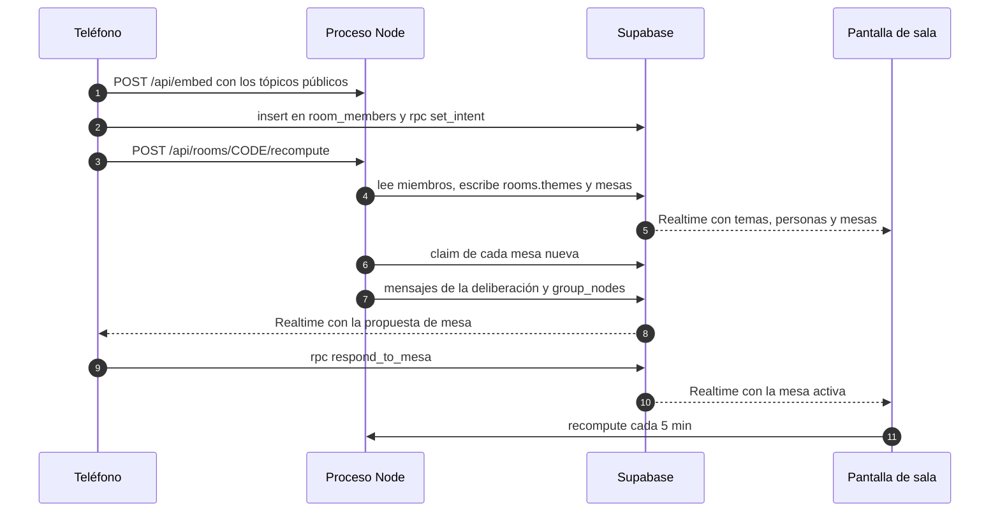

# Propuestas de infra

Documento de trabajo. Lista lo que falta decidir sobre **qué corre dónde**, a partir del estado del repo en `cfa7c67` (P0 y P1). Lo implementado o aceptado está marcado en el resumen; el resto no está acordado por el equipo.

## Cómo iterar

- Cada propuesta tiene un estado: `propuesta` → `aceptada` → `implementada`, o `descartada`.
- Al cambiar un estado, anotar la fecha y el porqué en la propuesta. Una propuesta descartada no se borra: queda con su motivo.
- Al implementar una, mover la decisión a `CLAUDE.md` (sección Decisiones) y actualizar ahí la tabla de base de datos.
- Propuestas nuevas: siguiente `I<n>`, mismo formato.

## Resumen

| ID | Propuesta | Estado | Frentes |
|---|---|---|---|
| [I1](#i1--intención-de-hoy-en-supabase) | Intención de hoy en una tabla que solo lee el servidor | propuesta | D, E1, seed |
| [I2](#i2--aceptar-una-mesa-por-función-de-base-de-datos) | Aceptar una mesa por función de base de datos | propuesta | E1 |
| [I3](#i3--claim-de-deliberación-e-id-de-mesa-determinista) | Claim de deliberación e id de mesa determinista | propuesta | C5, D4 |
| [I4](#i4--temas-guardados-y-realtime-en-rooms-y-room_members) | Temas guardados y Realtime en `rooms` y `room_members` | parcial: `room_members` en Realtime implementado | C5, E2 |
| [I5](#i5--embeddings-en-el-servidor) | Embeddings en el servidor | implementada | B4 |
| [I6](#i6--recálculo-sin-cron) | Recálculo sin cron | propuesta | C5, E |
| [I7](#i7--un-proceso-node-siempre-encendido) | Un proceso Node siempre encendido | aceptada | D4, deploy |
| [I8](#i8--buzón-para-el-conector-mcp) | Buzón para el conector MCP | propuesta | A5 |

I1, I2, I3, I4 e I8 son una sola [migración](#migración), ya probada (falta aplicarla; lo de `room_members` en Realtime ya salió aparte). Se pueden aplicar por separado.

## Flujo con todas las propuestas



## I1 · Intención de hoy en Supabase

**Estado:** propuesta

**Problema.** El guion dice que la intención de hoy "solo la ve su agente", pero el agente de miembro corre en una ruta de servidor y no hay dónde leerla. Las 18 personas del seed (`seed/people.ts`) no tienen teléfono ni intención.

**Propuesta.** Tabla `member_intents` con RLS y sin políticas: la clave publicable no puede leerla. El teléfono escribe con `rpc("set_intent")`; la deliberación lee con `supabaseAdmin`. Se borra en cascada con la sala.

**Costo.** La intención pasa por nuestro servidor mientras dura la sala. El pitch dice "no la ve ningún otro teléfono ni agente", no "nunca sale del teléfono".

**Alternativa.** Que cada teléfono dispare su propio agente al recibir la propuesta y mande la intención en esa llamada. No se guarda nada, pero un teléfono bloqueado frena la mesa y el seed igual necesita intenciones en el servidor.

**Para implementarla.** Migración; agregar una intención a cada `SeedPerson` y cargarla en `scripts/load-seed.mts`.

## I2 · Aceptar una mesa por función de base de datos

**Estado:** propuesta

**Problema.** La política `"accept or reject"` (`supabase/migrations/20261121160000_initial_schema.sql:79`) deja que el teléfono haga `update` de la fila completa de `group_nodes`. `aceptado` es un `jsonb`, así que aceptar es leer, modificar y escribir: dos personas que aceptan a la vez pueden pisarse y la mesa no llega a 3. Tampoco hay nada que cambie `status` a `activa`.

**Propuesta.** Función `respond_to_mesa(group_node_id, person_id, accepted)` que toma el lock de la fila, registra la respuesta y calcula el estado:

| Condición | `status` |
|---|---|
| Ya estaba `disuelta` | `disuelta` |
| 3 o más aceptan | `activa` |
| Quedan menos de 3 que no rechazaron | `disuelta` |
| Resto | `propuesta` |

Se elimina la política de `update` directo.

**Requisito.** `aceptado` tiene que nacer con **todos** los miembros en `null`: la función cuenta sobre esas claves y solo deja responder a quien está en ellas.

**Para implementarla.** Migración; el teléfono llama `supabase.rpc("respond_to_mesa", …)`.

## I3 · Claim de deliberación e id de mesa determinista

**Estado:** propuesta

**Problema.** El recálculo es completo y lo disparan varias cosas (I6). Sin identidad estable, la misma mesa se crea y se delibera más de una vez, y una mesa ya aceptada puede desaparecer en el recálculo siguiente.

**Propuesta.**

- `mesa.id` = hash de `roomId` y los `personId` ordenados. Las mesas nuevas se insertan con `on conflict do nothing`.
- Columna `mesas.deliberation_started_at`. Antes de deliberar: `update mesas set deliberation_started_at = now() where id = … and deliberation_started_at is null`, y se sigue solo si devolvió la fila.
- El recálculo no toca las mesas cuyo `group_node` está en `propuesta` o `activa`, y sus miembros cuentan para el tope de 2 mesas por persona.

**Abierto.** Qué pasa con una mesa `propuesta` cuando llega alguien que llenaría un rol que le falta: ¿se congela igual o se vuelve a proponer?

**Para implementarla.** Migración; la asignación del motor (C4) recibe las mesas ya vigentes como entrada.

## I4 · Temas guardados y Realtime en `rooms` y `room_members`

**Estado:** parcial. 21-11: `room_members` ya está en Realtime (`supabase/migrations/20261121180000_room_members_realtime.sql`). Siguen como propuesta `rooms.themes`, `rooms.computed_at` y `rooms` en Realtime.

**Problema.** El motor devuelve `{ themes, mesas }`, pero `Theme` (`src/lib/types.ts:43`) no tiene tabla: la pantalla de sala no tiene de dónde leer los temas. Tampoco se entera cuando llega alguien, porque `room_members` no está en la publicación de Realtime (`…initial_schema.sql:60`).

**Propuesta.** Columnas `rooms.themes` (jsonb) y `rooms.computed_at`, escritas por el recálculo. Agregar `rooms` y `room_members` a `supabase_realtime`.

**Datos.** Una proyección del seed pesa 9,8 KB en promedio y 22 KB como máximo (con embeddings). El tope de Realtime para Postgres Changes es 1 MB por mensaje.

**Ojo.** Un solo canal por cliente, filtrado por `room_id`. Los eventos `DELETE` no se pueden filtrar (por confirmar): descartar en el cliente los de otra sala.

## I5 · Embeddings en el servidor

**Estado:** implementada el 21-11 (`src/app/api/embed/route.ts`). Recibe `{ texts }` (1 a 100) y devuelve `{ embeddings }`.

**Medido** (Linux, `next start`): el modelo cargado ocupa unos 710 MB de RAM; la primera llamada tarda 0,8 s con el modelo ya en disco y las siguientes 20–100 ms por lote. Con 512 MB el proceso muere en la primera llamada.

**Problema.** `CLAUDE.md` deja abierto calcular los embeddings en el teléfono. El modelo (`src/lib/embeddings.ts:6`, `model_quantized.onnx`) pesa 118 MB: cada persona lo descargaría en el wifi de la sala antes de poder hacer check-in.

**Propuesta.** Ruta `POST /api/embed` que usa `embed()`. El teléfono manda los nombres de sus tópicos públicos y recibe los vectores.

**Alternativa.** Dejarlo en el teléfono y precargar el modelo durante el onboarding. Mantiene el "sin servidor", pero no está medido cuánto demora en un teléfono.

**Depende de** I7: con el proceso siempre encendido, el modelo se carga una vez.

## I6 · Recálculo sin cron

**Estado:** propuesta

**Propuesta.** Una ruta `POST /api/rooms/[code]/recompute` idempotente (gracias a I3). La llaman:

- el teléfono, después del check-in y de la salida;
- la pantalla de sala, cada 5 minutos.

**Costo.** Sin pantalla de sala abierta no hay recálculo periódico. En el demo siempre está abierta.

**Alternativa.** `pg_cron` + `pg_net` en Supabase, o un `setInterval` en un worker. Solo si hace falta recalcular sin pantalla.

## I7 · Un proceso Node siempre encendido

**Estado:** aceptada el 21-11. El deploy va en Render (`render.yaml`), plan `standard` (2 GB) por la memoria del modelo (ver I5). Vercel se descartó.

**Propuesta.** Correr la app con `next start` en un proceso que no se apaga (Render, Fly o una máquina), no en funciones serverless. Dos motivos:

- el modelo de embeddings queda cargado en memoria (I5);
- la deliberación corre en `after()` después de responder el recálculo, sin tope de duración. `after()` funciona en un servidor Node sin configuración extra (`node_modules/next/dist/docs/01-app/03-api-reference/04-functions/after.md`).

**No probado.** Si transformers.js corre bien en serverless. Si funciona, esta propuesta pierde su primer motivo.

**Cuándo levantar algo más:**

| Señal | Qué se levanta |
|---|---|
| La deliberación de una sala completa bloquea o tumba el proceso web | Un worker aparte que toma las mesas con `deliberation_started_at` nulo. El claim de I3 lo permite sin cambios. |
| Hay que recalcular sin la pantalla abierta | Un `setInterval` en ese worker. |
| `/api/embed` demora en el check-in | Precalcular los tópicos frecuentes al partir el proceso. |

## I8 · Buzón para el conector MCP

**Estado:** propuesta. Es lo primero que se corta si falta tiempo (A5).

**Propuesta.** El teléfono genera un código al azar. La ruta `/api/mcp/[code]` recibe `submit_profile` y deja las señales en `profile_inbox` bajo ese código. El teléfono las retira con `rpc("claim_profile")`, que borra la fila al devolverla. La tabla no se puede leer con la clave publicable.

## Migración

Cubre I1, I2, I3, I4 e I8. Va después de `20261121160000_initial_schema.sql`.

```sql
-- Themes are an engine output the room screen draws; computed_at tells it a recompute landed.
alter table rooms
  add column themes jsonb not null default '[]',
  add column computed_at timestamptz;

-- Set once by the route that deliberates a mesa, so concurrent recomputes never deliberate it twice.
alter table mesas add column deliberation_started_at timestamptz;

alter publication supabase_realtime add table rooms;

-- Read only by server routes: RLS is on and there are no policies.
create table member_intents (
  room_id text not null,
  person_id text not null,
  intent text not null,
  updated_at timestamptz not null default now(),
  primary key (room_id, person_id),
  foreign key (room_id, person_id) references room_members (room_id, person_id) on delete cascade
);
alter table member_intents enable row level security;

create function set_intent(p_room_id text, p_person_id text, p_intent text)
returns void
language sql security definer set search_path = public
as $$
  insert into member_intents (room_id, person_id, intent)
  values (p_room_id, p_person_id, p_intent)
  on conflict (room_id, person_id) do update set intent = excluded.intent, updated_at = now();
$$;

-- Mailbox for the MCP connector: the server drops signals under a code only the phone knows.
create table profile_inbox (
  code text primary key,
  signals jsonb not null,
  created_at timestamptz not null default now()
);
alter table profile_inbox enable row level security;

create function claim_profile(p_code text)
returns jsonb
language sql security definer set search_path = public
as $$
  delete from profile_inbox where code = p_code returning signals;
$$;

-- Phones used to update `aceptado` directly: two acceptances at once overwrote each other
-- and nothing moved the status. The row lock here makes each answer land.
drop policy "accept or reject" on group_nodes;

create function respond_to_mesa(p_group_node_id text, p_person_id text, p_accepted boolean)
returns setof group_nodes
language plpgsql security definer set search_path = public
as $$
declare
  answers jsonb;
  accepted int;
  rejected int;
  total int;
begin
  select aceptado into answers
  from group_nodes
  where id = p_group_node_id and aceptado ? p_person_id
  for update;
  if not found then
    return;
  end if;

  answers := answers || jsonb_build_object(p_person_id, p_accepted);
  select count(*) filter (where value = 'true'), count(*) filter (where value = 'false'), count(*)
  into accepted, rejected, total
  from jsonb_each(answers);

  return query
  update group_nodes
  set aceptado = answers,
      status = case
        when status = 'disuelta' then 'disuelta'
        when accepted >= 3 then 'activa'
        when total - rejected < 3 then 'disuelta'
        else 'propuesta'
      end,
      updated_at = now()
  where id = p_group_node_id
  returning *;
end;
$$;

grant execute on function set_intent, claim_profile, respond_to_mesa to anon, authenticated;
```

**Probada el 21-11** sobre el esquema inicial, en un Postgres 14 desechable con los roles `anon` y `service_role` simulados:

| Prueba | Resultado |
|---|---|
| 4 respuestas simultáneas a la misma mesa, 40 rondas | 0 respuestas perdidas; la mesa siempre queda `activa` |
| 6 claims simultáneos de la misma mesa, 20 rondas | Siempre 1 solo ganador |
| `anon` lee `member_intents` o `profile_inbox` | 0 filas |
| `anon` hace `update` directo a `group_nodes` | 0 filas afectadas |
| Un no miembro responde; se responde a una mesa `disuelta` | No cambia nada |
| Borrar la sala | No queda ninguna fila hija |

**No probada** contra Supabase (local ni nube) ni con Realtime real.

## Fuera de alcance

Decidido no invertir en esto durante el hack: login o identidad verificada, límite de gasto de la API de Claude, pipeline de deploy.

## Preguntas abiertas

- I1: ¿el equipo acepta que la intención pase por el servidor? Cambia una frase del pitch.
- I3: ¿una mesa `propuesta` se congela o se vuelve a proponer cuando llega alguien que calza mejor?
- I5: ¿cuánto demora el modelo en un teléfono real? Nadie lo midió.
- I7: ¿dónde se despliega?
