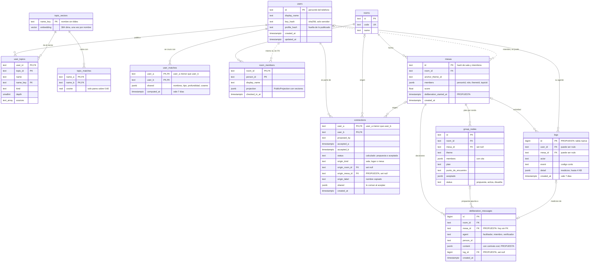

# Modelo de datos

*Diagrama de Usuario, Conexión, Mesa y Log calzado con las tablas que ya existen — requisitos con su fuente, decisiones, entidades, cinco flujos recorridos y qué cambia para el resto del equipo.*

> **Estado (21-11-2026, noche):** Usuario y Conexión están **implementados en la rama `feat/usuario-conexiones`** (migración `20261121230000_users_and_connections.sql`, sin empujar ni aplicar a ninguna base), con las tres decisiones que tomó Benjamín ese mismo día. Mesa y Log son **propuesta**: no hay migración ni código. Nada de esto se probó contra Supabase real; la migración de Usuario y Conexión corre en un Postgres en memoria (PGlite) dentro de `pnpm test`.

## Antes de seguir: un choque que resolver

El plan con que se pidió este documento dice "sin pgvector" y "sin migraciones hasta validar el diagrama". Cuando llegó, Usuario y Conexión ya estaban escritos con lo que Benjamín eligió al responder la propuesta de esa tarde: clave del dispositivo, borrar la fila al retirarse, y pgvector con el cruce calculado siempre y guardado una semana. El diagrama de abajo refleja eso. Queda en pausa todo lo que falta (Mesa, Log y cualquier cambio a la migración) hasta que Benjamín valide.

## Requisitos

| # | Requisito | Fuente | Dato que exige guardar | Escribe | Lee | Vive |
|---|---|---|---|---|---|---|
| F1 | Check-in con proyección pública | `CLAUDE.md:58`, `src/app/api/checkin/route.ts` | Proyección filtrada por sala | Servidor | Todos los de la sala | Lo que dure la sala |
| F2 | Una persona es la misma entre salas | Encargo de Benjamín; hoy no existe (`docs/arquitectura-por-capas.md:295`) | Identidad y tópicos públicos | Servidor, en el check-in | Servidor | Persistente |
| F3 | Cruce de dos personas sin recalcular todo | Encargo de Benjamín; `CLAUDE.md:117` (Coincidencia) | Qué nombres de tópico calzan; resultado por pareja | Servidor | Las dos personas | Calce de nombres: persistente. Resultado: 1 semana |
| F4 | Conexión aceptada por ambas partes | Encargo; `docs/casos-de-uso.md:17` y `:97` | Pareja, quién aceptó y cuándo, origen, lo común | Servidor | Solo sus dos partes | Hasta que una se retira |
| F5 | Mesas candidatas de 3 a 5 | `docs/arquitectura-por-capas.md:20`, `:274` | Miembros, rol, tema, puntaje | Motor de sala | Ver decisión D6 | Lo que dure la sala |
| F6 | Plan de la mesa con aceptaciones | `docs/arquitectura-por-capas.md:241`, `CLAUDE.md:18` | Plan, punto de encuentro, citas, quién aceptó | Deliberación; el teléfono acepta | Ver D6 | Lo que dure la sala |
| F7 | Decisiones principales de los agentes | Encargo de Benjamín; `docs/arquitectura-por-capas.md:231` | Propuesta, respuesta de cada agente, descartes | Orquestador de la deliberación | Ver D6 | Como la mesa |
| F8 | Logs: el resto de la actividad | Encargo de Benjamín | Usuario, mesa, fecha, qué pasó, medición | Servidor | El dueño lee los suyos; el resto, solo servidor | 1 semana |
| N1 | Solo capa pública; lo privado no se expone | `docs/arquitectura-por-capas.md:15`, `CLAUDE.md:70` | Ninguna columna con texto privado | — | — | — |
| N2 | Texto de los agentes filtrado antes de ser público | `docs/revision-filtro-privacidad.md:99`, `CLAUDE.md:70` | Plan, cita, punto de encuentro y motivo pasan por `screenText()` y `mentionsPrivate()` | Frente D | — | — |
| N3 | Sin coordenadas | `CLAUDE.md:66` (proximidad) | Posiciones solo en memoria del proceso | — | — | No se guardan |
| N4 | Tope de 1 MB por mensaje de Realtime | `docs/infra-propuestas.md:108` | Filas chicas en las tablas publicadas | — | — | — |
| N5 | Un proceso Node de 2 GB | `CLAUDE.md:114`, `docs/infra-propuestas.md:141` | La base hace los cruces; el servidor no carga vectores | — | — | — |
| N6 | De 18 a 200 personas por sala | `CLAUDE.md:141`; `CLAUDE.md:130` (simulación con 200) | Índices por pareja, por mesa y por fecha | — | — | — |
| N7 | Borrado al cerrar la sala | `supabase/migrations/20261121160000_initial_schema.sql:1`, `docs/arquitectura-por-capas.md:266` | Cascada desde `rooms` | — | — | Ver D2 |

## Decisiones

| # | Tema | Estado | Qué quedó o qué se propone |
|---|---|---|---|
| D1 | Identidad sin login | **Decidido por Benjamín** | Clave del dispositivo: el teléfono inventa un secreto y el servidor guarda su hash la primera vez que lo ve. El `personId` que ya genera el teléfono es `users.id`. Distinto del plan: el id no lo genera el servidor y `room_members.person_id` no pasó a ser FK, para no tocar esa tabla. |
| D2 | Qué sobrevive a la sala | **Abierto** | Hoy sobreviven `users`, sus tópicos y `connections`. Recomendación: que mesas, planes y decisiones sigan borrándose con la sala, como promete N7; el teléfono guarda su copia. Alternativa: que persistan, cambiando tres FK a `set null` y la regla de `CLAUDE.md`. |
| D3 | Dónde viven los embeddings | **Decidido por Benjamín: pgvector** | Un vector por nombre de tópico en `topic_vectors`. `room_members.projection` sigue con vectores porque `/grafo` y `/explorar` los leen desde el navegador; adelgazarla queda pendiente. Choca con el "sin pgvector" del plan. |
| D4 | Cruce entre dos personas | **Decidido por Benjamín** | Se calcula siempre, porque es barato, y el resultado queda una semana. Los grafos entre todos se calculan en el momento. En vez de versión de perfil, el resultado guardado se borra cuando cualquiera de los dos cambia lo que publica. |
| D5 | Retirarse de una conexión | **Decidido por Benjamín** | Se borra la fila. Consecuencia: no queda memoria de que se retiró, así que pueden volver a proponerse o a sugerirse entre sí. Rechazar una propuesta hace lo mismo. |
| D6 | Quién lee una mesa y sus decisiones | **Abierto** | Recomendación: toda la sala, como hoy, porque el guion de demo muestra las mesas y a los agentes en el proyector (`CLAUDE.md:17`) y el contenido es solo capa pública. Alternativa: solo sus participantes, por rutas con la clave del dispositivo; el proyector pierde el panel en vivo. |
| D7 | Qué es una decisión principal | Propuesta | Un mensaje que cambia el estado de la mesa y se le muestra a las personas. Tres tipos, que ya existen como valores de `deliberation_messages.agent`: la propuesta del facilitador, la respuesta de cada agente de miembro y un descarte del verificador. La escribe el orquestador (código), nunca el modelo. Todo lo demás va a `logs`. |

## Diagrama

## Entidades

Tres capas. **Hecho** = implementado y con tests en la rama. **Existe** = ya está en `main`. **Propuesta** = sin escribir.

### Identidad y perfil (persistente)

| Tabla | Estado | Clave y relaciones | Índices | Escribe | Lee | Vive |
|---|---|---|---|---|---|---|
| `users` | Hecho | PK `id` | — | Servidor (`save_profile`, `claim_key`) | Solo servidor | Persistente |
| `user_topics` | Hecho | PK (`user_id`, `topic_id`); FK a `users` en cascada; FK a `topic_vectors` | La PK | Servidor, en cada check-in que cambia el perfil | Solo servidor | Se reemplaza al cambiar el perfil |
| `topic_vectors` | Hecho | PK `name_key` | — | Servidor, la primera vez que aparece un nombre | Solo la base | Persistente |
| `topic_matches` | Hecho | PK (`name_a`, `name_b`); FK a `topic_vectors` en cascada. Van los dos sentidos y el nombre consigo mismo | La PK | La base, al entrar un nombre nuevo | Solo la base | Persistente |

### Presencia (efímera)

| Tabla | Estado | Clave y relaciones | Índices | Escribe | Lee | Vive |
|---|---|---|---|---|---|---|
| `rooms` | Existe, sin cambios | PK `id`; `code` único | — | Seed | Todos | Hasta que se borra |
| `room_members` | Existe, sin cambios | PK (`room_id`, `person_id`); FK a `rooms` en cascada | `room_id` | Servidor (`/api/checkin`) | Todos, y por Realtime | Con la sala |
| Posiciones | Existe | En memoria del proceso (`src/lib/proximity/`) | — | — | Nadie: sale distancia y rumbo | Minutos |

### Vínculos y actividad

| Tabla | Estado | Clave y relaciones | Índices | Escribe | Lee | Vive |
|---|---|---|---|---|---|---|
| `user_matches` | Hecho | PK (`user_a`, `user_b`) con `user_a < user_b`; FK a `users` en cascada | `user_b`, `computed_at` | Servidor, en cada cruce | Sus dos personas, por `/api/matches` | 7 días, o hasta que un perfil cambia |
| `connections` | Hecho; `origin_mesa_id` es propuesta | PK (`user_a`, `user_b`) con `user_a < user_b`; FK a `users` en cascada; FK a `rooms` y a `mesas` con `set null` | `user_b` | Servidor (`propose`, `accept`, `close`) | Sus dos partes, por `/api/connections` | Hasta que una la cierra |
| `mesas` | Existe; se agrega `deliberation_started_at` y un índice | PK `id` = hash de la sala y los miembros ordenados (`docs/infra-propuestas.md:92`); FK a `rooms` en cascada | `room_id`; GIN sobre `members` para "mis mesas" | Motor de sala | Ver D6 | Con la sala (D2) |
| `group_nodes` | Existe, sin cambios de columnas | PK `id`; FK a `rooms` en cascada y a `mesas` con `set null` | `room_id` | Deliberación; aceptar pasa a la función `respond_to_mesa` (`docs/infra-propuestas.md:63`) | Ver D6 | Con la sala (D2) |
| `deliberation_messages` | Existe; pasa a ser "las decisiones principales" | PK `id`; FK a `rooms` en cascada; **nueva** FK `mesa_id` a `mesas` en cascada; **nueva** `log_id` a `logs` con `set null` | (`room_id`, `created_at`); nuevo (`mesa_id`, `created_at`) | Orquestador de la deliberación | Ver D6, y por Realtime | Con la mesa |
| `logs` | Propuesta | PK `id`; FK `user_id` a `users` y `mesa_id` a `mesas`, ambas en cascada y anulables (al menos una presente) | (`mesa_id`, `created_at`), (`user_id`, `created_at`) | Solo servidor; solo se agrega | El dueño lee las filas con su `user_id`; las demás, solo servidor. Sin Realtime | 7 días |

## Mesa y Log: cómo se reutiliza lo que hay

Ningún código escribe hoy `mesas`, `group_nodes` ni `deliberation_messages`, así que ajustarlas no rompe nada.

- **Mesa = `mesas`.** Los involucrados siguen en `members` (jsonb), como dice el contrato `MesaSchema`. No propongo una tabla `mesa_members`: el motor escribe la mesa en una fila, Realtime la entrega en un mensaje y el índice GIN responde "mis mesas". Costo: los miembros no tienen FK a `users`, igual que `room_members`.
- **Decisiones principales = `deliberation_messages`.** Ya tiene mesa, agente, persona, contenido y fecha, y ya está en Realtime para el panel de la sala. Se le agrega la FK a la mesa, un contrato zod para `content` y `log_id`.
- **Plan vigente = `group_nodes`.** Sin columnas nuevas. Una revisión del plan es una fila nueva y la anterior pasa a `disuelta`.
- **Log = tabla nueva `logs`.** Es la única tabla nueva de esta parte.

Contenido de una decisión, según quién la produce:

| `agent` | `content` | Texto libre |
|---|---|---|
| `facilitador` | `{ round, groupNodeId }`: apunta al plan en `group_nodes`, no lo copia | Ninguno aquí; el plan vive en `group_nodes` |
| `miembro` | `{ decision: accept, reject o adjust, motivo }` | `motivo`, una línea de hasta 140 caracteres |
| `verificador` | `{ descartado: rol o mesa, personId, razon }` con `razon` como código | Ninguno |

**Un output de agente se guarda una sola vez.** Cada llamada a un modelo deja una fila en `logs` con la medición (modelo, milisegundos, tokens, intento, resultado). Si el output produjo una decisión, el contenido vive en la decisión y esta apunta al log con `log_id`. Si no la produjo (JSON inválido, rol descartado, línea bloqueada por privacidad), el log guarda el código del resultado; guarda además el output descartado solo cuando viene del facilitador, que no ve nada privado.

**Lo que `logs` nunca guarda:** prompts, la intención de hoy, `personality`, texto libre de un agente de miembro, coordenadas, vectores, ni eventos de proximidad.

**Volumen de `logs`.** Con 200 personas y el tope de 2 mesas por persona caben a lo más unas 133 mesas a la vez. Una deliberación completa son hasta 2 rondas de 1 facilitador y 5 miembros: unas 14 filas de log y 13 decisiones. Una ola entera son cerca de 1.900 logs; a unos 300 bytes por fila, medio MB. Diez olas en un evento no llegan a 10 MB. No hace falta un tope; el vencimiento de 7 días se justifica por privacidad, no por tamaño, y se aplica borrando lo vencido al insertar, como ya hace `user_matches`. Esta cuenta es una estimación: nada de la deliberación existe todavía.

**Mesa y Conexión.** Una mesa no crea conexiones sola. Quien está en una mesa puede proponerle una conexión a otro miembro con `origin: { mesaId }`; cada pareja acepta por separado. La conexión guarda el nombre del tema, que sobrevive si la mesa se borra.

## Flujos recorridos

**1. Onboarding, perfil y check-in.** El onboarding no toca la base: las señales pasan por un buzón en memoria y el nodo vive en el teléfono. En `POST /api/checkin` se lee 1 fila de `rooms` y se escribe 1 de `room_members` (10 a 22 KB, la misma que sale por Realtime). `save_profile` lee y escribe 1 fila de `users`. Si el perfil cambió, guarda 1 `topic_vectors` por cada nombre que nadie había publicado, sus pares en `topic_matches`, reemplaza hasta 60 `user_topics` y borra los `user_matches` de esa persona. Si no cambió, no escribe nada más.

**2. Dos personas se cruzan.** `match_users` lee los `user_topics` de ambas (hasta 60 cada una, por la PK) y los pares de `topic_matches` que parten de los nombres de la primera. No lee ni compara vectores. Escribe 1 fila en `user_matches` si comparten algo y ninguna si no. Con el seed real, los 756 cruces dan lo mismo que comparar los vectores directamente, y uno toma 0,15 ms en PGlite. Listar "mis coincidencias" lee solo `user_matches`.

**3. Propuesta, aceptación y retiro.** Proponer lee 1 `rooms` (para copiar el nombre) e inserta 1 `connections` con la aceptación de quien propone. Aceptar actualiza esa fila con la segunda aceptación y con lo común (el mismo join del flujo 2); el estado pasa solo a `aceptada`. Si los dos proponen a la vez queda una fila, aceptada. Retirarse o rechazar borra la fila.

**4. Mesa, deliberación, decisión y aceptación (propuesta).** El motor inserta 1 `mesas`; si ya existe ese grupo, no hace nada. La deliberación la toma marcando `deliberation_started_at`. Cada llamada a un agente inserta 1 `logs`. El plan verificado inserta 1 `group_nodes` y 1 decisión del facilitador. Cada respuesta de un agente de miembro inserta 1 decisión. Un descarte del verificador inserta 1 decisión sin log, porque no hay llamada que medir. Aceptar en el teléfono llama a `respond_to_mesa`, que actualiza 1 `group_nodes` bajo lock y lo pasa a `activa` con 3 aceptaciones. El teléfono lee su mesa por el índice GIN, luego el plan y las decisiones por (`mesa_id`, `created_at`).

**5. Salida y cierre.** Salir borra 1 `room_members`; si la mesa queda con menos de 3, su `group_nodes` pasa a `disuelta`. Borrar la sala arrastra `room_members`, `mesas`, `group_nodes`, `deliberation_messages` y, por la mesa, sus `logs`. Quedan `users`, `user_topics`, `topic_vectors`, `topic_matches` y `connections`, con el origen sin sala pero con su nombre. `user_matches` y los logs sin mesa vencen a los 7 días. Las posiciones nunca se guardaron.

## Revisión de privacidad y tamaño

| Columna con texto | Qué puede traer | Control |
|---|---|---|
| `users.display_name`, `room_members.display_name` | Nombre visible | `hasIdentifier()` en el check-in |
| `user_topics.name`, `shared` en `user_matches` y `connections` | Nombres de tópicos públicos | Filtro de privacidad completo en el check-in |
| `connections.origin_label` | Nombre de la sala o del lugar | El de la sala lo copia la base; el del lugar pasa `hasIdentifier()` |
| `group_nodes.plan`, `punto_de_encuentro`, `members[].cita`; `motivo` de una decisión | **Texto escrito por un agente** | Hoy ninguno (`docs/revision-filtro-privacidad.md:99`). El frente D tiene que pasar cada línea por `screenText()` y `mentionsPrivate()` antes de insertar. La base no puede comprobarlo |
| `logs.detail` | Medición de una llamada | Sin texto de agentes de miembro; tope de 4 KB por fila |

- **Texto privado:** las únicas columnas donde podría caer son las cuatro de la fila marcada. No queda garantizado por construcción, sino por una regla que el frente D debe cumplir.
- **Coordenadas:** ninguna columna las admite. El nombre del lugar es el que ya muestra el teléfono.
- **Realtime:** el mensaje más grande sigue siendo una fila de `room_members` (hasta 22 KB, contra 1 MB). Una decisión o un plan pesan menos de 2 KB. Las tablas de Usuario, Conexión y Log no están en Realtime.
- **La clave publicable del teléfono:** no lee ninguna tabla de Usuario ni de Conexión, ni ejecuta sus funciones; probado en `src/lib/users/users.test.ts`. `logs` seguiría la misma regla.

## Qué cambia para el resto

| Quién | Hoy, con Usuario y Conexión | Si se aprueba Mesa y Log |
|---|---|---|
| `/api/checkin` | Responde igual. Además guarda el perfil y acepta `Authorization: Bearer <clave>` opcional. Si falla guardar el perfil, el check-in sigue | Nada |
| `/explorar`, `/grafo` | Nada: `room_members` no cambió | Si D6 queda en "solo participantes", dejan de poder leer mesas con la clave publicable |
| Teléfono | Tiene que usar **un solo** `personId` (hoy conviven `nodo.phone.v1`, `team38.person.v1` y `team38.me`) y guardar una clave de 32 caracteres o más. Coincidencias puede usar `POST /api/matches` en vez de comparar por nombre; las relaciones, `/api/connections` | Conversaciones lee mesas, planes y decisiones |
| Seed | `scripts/load-seed.mts` también crea los usuarios. Los del seed no tienen clave | Mesas escritas a mano, si el frente D las necesita |
| Frente C (motor) | Nada | `mesa.id` como hash; no tocar mesas con plan vigente |
| Frente D (deliberación) | Nada | Escribe logs y decisiones con un helper; filtra todo texto antes de insertar |
| `CLAUDE.md` | Ya anota las tablas, rutas y decisiones de Usuario y Conexión | Anotar el contrato de `content`, `logs` y lo que salga de D2 y D6 |

## Pendiente fuera de este documento

- La política `"leave room"` deja que cualquiera borre la membresía de otra persona con la clave publicable (`initial_schema.sql:78`). Se cierra con una ruta que pida la clave del dispositivo.
- El check-in no exige la clave: conociendo un `personId` se puede pisar la proyección de esa persona.
- La intención de hoy no está en este modelo; `docs/infra-propuestas.md:49` propone `member_intents`.
