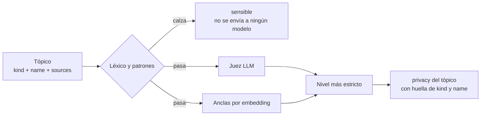
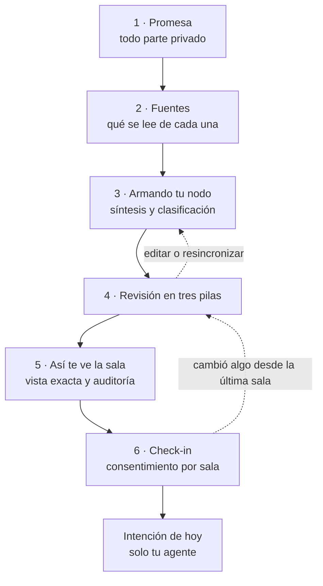

# Onboarding y capa privada

*Cómo se decide qué parte del nodo personal es pública, qué recomendamos compartir y qué verificaciones impiden que lo privado llegue a una sala.*

**Estado:** propuesta (21-11). Detalla los pasos B1, B3 y B4 de [plan-de-construccion](plan-de-construccion.md) y la línea "Datos sensibles: lista fija de exclusión más un clasificador" de [arquitectura-por-capas](arquitectura-por-capas.md). No cambia la decisión "solo capa pública": lo privado sigue sin usarse para calzar, y este documento define cómo se garantiza. El filtro y el contrato ya están en el código (ver [Qué está construido](#qué-está-construido)); el onboarding, el auditor y el check-in por servidor siguen como propuesta.

## La regla

> **Un tópico entra a una sala solo si su dueño lo publicó a mano y pasó todas las verificaciones vigentes. Si cualquier verificación falla, no responde o está desactualizada, el tópico se trata como privado.**

Tres consecuencias que ordenan todo el diseño:

1. **La sala no puede filtrar lo que no tiene.** Lo privado vive en el teléfono (IndexedDB) y no se sube. La única puerta de salida es `toPublicProjection()`.
2. **Recomendar no es publicar.** Los modelos clasifican y sugieren; solo un toque de la persona publica. Un modelo puede **subir** el nivel de cuidado de un tópico, nunca bajarlo.
3. **Publicar aquí es proyectar.** La sala se muestra en un proyector con tu nombre. La pregunta que guía el onboarding es: *¿lo dirías en voz alta frente a la sala?*

## Qué está construido

`src/lib/privacy/`, con tests junto a cada archivo. Los pasos 1, 2 y 5 de [Qué se construye en el hack](#qué-se-construye-en-el-hack), y la parte de anclas del paso 8.

| Archivo | Qué hace | Verificación |
|---|---|---|
| `screen.ts` | `screen()`: patrones de dato de contacto y léxico por categoría. Pura y síncrona, para teléfono, servidor y tests | V1, V4, V6 |
| `anchors.ts` | Frases ancla por categoría, comparadas por embedding | apoyo de V2 |
| `judge.ts` | Juez `claude-haiku-5-5` con salida estructurada, sin thinking, en lotes de 4 en paralelo. Recibe `kind`, `name` y `sources`; nunca `evidence`. Devuelve nivel, categoría y versión general | V2 |
| `classify.ts` | `classifyTopics()`: junta las tres capas y devuelve el `privacy` de cada tópico | V2 |
| `signals.ts` | `splitSignals()`: antes de sintetizar, retiene las señales que bloquea el léxico y quita `evidence` de las demás | V1 |
| `projection.ts` | `toPublicProjection()` y `projectNode()`: la única salida del teléfono | V4 |
| `checkin.ts` + `/api/checkin` | El servidor clasifica de nuevo lo que recibe (léxico, anclas y juez), rechaza lo `sensible` y lo que no tiene veredicto, calcula los embeddings y escribe con la clave de servicio | V6 |
| `server.ts` + `/api/privacy/classify` | Veredictos para el teléfono, con caché en memoria por (`kind`, `name`, `sources`) compartida con el check-in | V2, V3 |
| `canary.test.ts` | Peor caso: un juez que aprueba todo, un dueño que comparte todo y un teléfono que se salta sus controles. Lo que bloquea el léxico igual no llega a la sala, y `evidence` no sale | V8 |
| `eval-set.ts` | Lista de prueba con nivel esperado: sensibles obvios, sensibles dichos con otras palabras, personales y seguros cercanos a una categoría | Tests y `pnpm privacy:eval` |

Cómo se combinan las capas:



- **Nunca baja.** El juez puede subir un nivel; no puede bajar lo que marcó una capa local.
- **Falla cerrado.** Sin respuesta del juez (error, tiempo agotado, negativa, índice faltante o repetido) el tópico queda en `personal`: se puede publicar, pero solo con un toque explícito y nunca como recomendado.
- **El veredicto vale para un texto.** `checkedFor` guarda la huella de `kind`, `name` y la versión del clasificador. Renombrar el tópico, cambiarle el `kind` o subir `CLASSIFIER_VERSION` lo devuelve a privado.

Medición del 21-11 con `pnpm privacy:eval` y el juez por defecto, Haiku 5.5, en tres corridas (no es determinista: entre corridas cambian de nivel 1 a 3 casos, nunca hacia `segura`):

| Qué | Resultado |
|---|---|
| Fugas: delicado clasificado como seguro | 0 de 110 |
| Sensibles (56) | 54 a 56 quedan `sensible`; el resto en `personal` |
| Sensibles escritos para engañar al filtro (35): remedios, jerga, inglés, inferencia, texto que le da órdenes al juez | 34 quedan `sensible`, 1 en `personal`. Las capas locales solas marcan 4 |
| Personales (19) | 16 a 19 quedan `personal`; el resto sube a `sensible` |
| Seguros cercanos a una categoría (75) | 70 a 71 quedan `segura`. Por las anclas, siempre van a "Tú decides" "es · psicóloga" y "quiere_ser · psiquiatra"; el juez retiene además 1 o 2 ("arte sacro", "asesoría previsional") |
| Seed (132 tópicos) | 129 quedan `segura`; "busca · nuevo trabajo en ia", "le_gusta · filosofía política" y un tópico de fintech que cambia en cada corrida van a "Tú decides" |
| Latencia de un perfil real (46 tópicos) | 1,5 a 2,0 s. Las capas locales son 7 ms y ~150 ms de eso |

El juez se cambia por deploy con `PRIVACY_JUDGE_MODEL` (`haiku` u `opus`); el servidor escribe al arrancar `[privacy] juez: <modelo>`. Los mismos casos con cada modelo:

| | Haiku 5.5 (3 corridas) | Sonnet 5.5 (2) | Opus 5.5 (3) |
|---|---|---|---|
| Delicados que quedan `segura` (de 110) | 0 | 0 | 0 |
| Sensibles que quedan `sensible` (de 91) | 88 a 90 | 91 | 91 |
| Seguros que quedan `segura` (de 75) | 70 a 71 | 72 | 72 |
| Seed que queda `segura` (de 132) | 129 | 129 | 130 |
| Perfil real de 46 tópicos | 1,7 a 2,0 s | 4,8 a 5,3 s | 2,3 a 2,8 s |

Opus y Sonnet dieron lo mismo en todas sus corridas, y con ellos los únicos seguros retenidos vienen de las anclas. Sonnet no quedó como opción: mismo resultado que Opus y el doble de latencia.

Tres diferencias con lo propuesto más abajo, por medición:

- **Las anclas suben a `personal`, no bloquean, y no se usan en el check-in.** El modelo de embeddings no separa vivir un tema de saberlo: "psiquiatra" como oficio da 0,85 contra "sesiones con mi psiquiatra" y "filosofía política" del seed da 0,74. Con cualquier umbral que atrape algo, bloquear deja fuera oficios, y como un nivel nunca baja el juez no puede corregirlo. Como alerta sí sirven: con umbral 0,66 marcan la mitad de los sensibles dichos con otras palabras, a cambio de mandar a "Tú decides" 2 de 50 seguros de la lista y 1 de 132 tópicos del seed. Tampoco se aplican a `sabe` y `ofrece`.
- **El motivo (`reason`) es una plantilla por categoría, no texto del modelo.** Pedirle la frase al juez duplicaba los tokens de salida, que son lo que fija la latencia: un perfil de 30 bajó de ~3 s a ~1,3 s al quitarla.
- **Un dato de contacto (correo, teléfono, RUT, usuario, URL) es `sensible`, no `personal`.** Nunca es un tópico válido.

De [Lo que hay que corregir en el repo](#lo-que-hay-que-corregir-en-el-repo) están hechos los puntos 1, 2 (migración `20261121200000_checkin_by_server.sql`) y 4 (`SynthesisSignalSchema`). Falta `motivo` por código (punto 3), que depende del frente D, y el auditor del conjunto público (V5).

El servidor admite los tópicos `personal`: publicarlos es decisión del dueño, y esa decisión se exige en el teléfono (`decidedBy: "user"` en `projectNode()`). El servidor no puede comprobar el toque, solo que el tópico no sea `sensible`.

## Tres niveles

Cada tópico recibe un nivel. El nivel define el valor por defecto y cuánta fricción tiene publicarlo.

| Nivel | Qué es | En el onboarding | ¿Puede entrar a una sala pública? |
|---|---|---|---|
| **segura** | Lo que sabes, haces, te gusta u ofreces, dicho en general | "Recomendado para compartir". Se publica en grupo con un toque | Sí |
| **personal** | Te identifica, te ubica, expone a un tercero o te puede costar algo | "Tú decides". Una tarjeta por tópico, con el motivo y una versión general sugerida | Sí, tópico por tópico |
| **sensible** | Categorías especiales: lo que la ley y el sentido común protegen | "Se queda contigo". Con candado y el motivo | **No** (ver [Preguntas abiertas](#preguntas-abiertas)) |

### Qué es sensible

Nunca entra a una sala pública. La lista parte de los datos sensibles de la ley chilena (Ley 19.628, art. 2 g, y la lista ampliada de la Ley 21.719, cuya vigencia está fijada para el 1 de diciembre de 2026 con un proyecto de postergación en trámite; **el texto exacto está por confirmar contra la BCN**).

| Categoría (`category`) | Ejemplos de tópico | Cómo se cuela |
|---|---|---|
| `salud` | diagnósticos, terapia, medicamentos, fertilidad, embarazo, adicciones, discapacidad | Preguntas a Claude o ChatGPT; podcasts de salud mental; cuentas seguidas |
| `sexualidad_genero` | orientación, identidad de género, vida sexual, apps de citas | Cuentas seguidas en Instagram; artistas y playlists |
| `politica` | militancia, a quién votas, postura sobre un conflicto, sindicato | Podcasts; cuentas seguidas; intereses inferidos por Meta |
| `religion` | credo, iglesia, prácticas (ayuno, retiro) | Música religiosa en Spotify; cuentas seguidas |
| `origen` | origen étnico o racial, nacionalidad, situación migratoria | Preguntas sobre visas o trámites |
| `situacion_economica` | deudas, sueldo, cesantía, quiebra, beneficios sociales | Preguntas a asistentes sobre créditos o finiquitos |
| `legal` | juicios, antecedentes, denuncias, pensión de alimentos | Preguntas a asistentes |
| `menores` | cualquier dato sobre un niño identificable | "papá de Sofía, 6 años, colegio X" |

### Qué es personal

Privado por defecto; publicable con un toque explícito y viendo el motivo.

| Categoría | Ejemplos | Versión general sugerida |
|---|---|---|
| `identificable` | empleador más cargo, RUT, teléfono, correo, usuario de redes, dirección | "jefe de riesgo en Banco X" → "riesgo financiero" |
| `ubicacion_rutina` | barrio, gimnasio y horario, colegio de los hijos, viajes con fecha | "entreno a las 7 en el gimnasio Y" → "entrenamiento de fuerza" |
| `terceros` | pareja, familia, amigos, clientes y jefes con nombre | No se sugiere versión: el dato es de otra persona |
| `laboral_delicado` | busca trabajo, quiere renunciar, conflicto con el equipo, sueldo | "busca trabajo en producto" → "busca: conversar sobre roles de producto" |
| `confidencial` | proyecto en reserva, clientes, cifras, cosas bajo NDA | "integración con el banco X" → "open banking" |
| `vida_intima` | duelo, separación, soledad, hábitos (alcohol, sueño) | Se sugiere dejarlo privado |
| `unico` | un tópico tan específico que te señala aunque no tenga tu nombre | "api-de-pagos-de-banco-x" → "apis de pagos" |

### Qué es seguro

Un tópico se recomienda solo si cumple **todo** esto, no por descarte:

- Es conocimiento, oficio, práctica, gusto, oferta o búsqueda (`sabe`, `hace`, `le_gusta`, `ofrece`, `busca`, `quiere_ser`), dicho en general.
- No nombra personas, empresas, lugares exactos ni fechas.
- Lo podrían tener varias personas de la sala.
- No viene solo de una inferencia pasiva (Spotify, Instagram) sobre un tema cercano a una categoría sensible.
- Los cuatro verificadores de abajo lo dejan pasar.

Ejemplos del seed (`seed/people.ts`): escalada, diseño ux, python, jazz, juegos de mesa, cocina peruana, fotografía de naturaleza.

### El `kind` cambia el nivel

El mismo tema puede ser un oficio o una confidencia. Por eso se clasifica el par (`kind`, `name`), nunca el nombre solo.

| Tópico | Nivel | Por qué |
|---|---|---|
| `sabe` · psicología clínica | segura | Es su oficio |
| `busca` · terapia para la ansiedad | sensible · `salud` | Habla de su salud |
| `sabe` · ciencia política | segura | Es conocimiento |
| `es` · militante de un partido | sensible · `politica` | Es su afiliación |
| `ofrece` · asesoría en finanzas personales | segura | Es una oferta |
| `busca` · salir de mis deudas | sensible · `situacion_economica` | Es su situación |
| `busca` · cofundador técnico | segura | Búsqueda profesional general |
| `busca` · trabajo nuevo | personal · `laboral_delicado` | Su jefe puede estar en la sala |

### Riesgo por fuente

| Fuente | Qué suele traer de delicado | Regla |
|---|---|---|
| Claude, ChatGPT, Gemini | Lo más delicado de todo: salud, plata, trabajo, pareja, problemas legales | El prompt ya los excluye ([mcp-ingestion](archivo/mcp-ingestion.md)), pero no se confía en eso: todo pasa por los verificadores |
| Spotify | Podcasts (política, religión, salud mental, crianza), música religiosa | Se publican géneros, no podcasts sueltos. Un tópico que solo viene de Spotify nunca se recomienda si roza una categoría sensible |
| Instagram | Cuentas seguidas, intereses publicitarios inferidos por Meta, lugares etiquetados, nombres de amigos | Los intereses inferidos y los lugares entran como `personal`. Los nombres de terceros nunca se vuelven tópico |
| GitHub | Nombre del empleador o de clientes en repos y organizaciones | Se publican lenguajes y temas, no nombres de repos |

## El onboarding

Seis pantallas en el teléfono. Reemplazan "Fuentes → Mi nodo" del paso E1.



| # | Pantalla | Qué ve la persona | Qué pasa por debajo |
|---|---|---|---|
| 1 | **Promesa** | Tres líneas: "Todo parte privado. Nada sale sin que lo apruebes. La sala es un proyector: comparte lo que dirías en voz alta." Elige cómo aparece (nombre de pila o apodo). | `displayName` también es público: por defecto solo el nombre de pila. |
| 2 | **Fuentes** | Cada fuente con lo que se lee y lo que no ("de Spotify: tus artistas y podcasts; no tus playlists privadas"). Aviso: "para armar tu nodo, un modelo de IA lee tus señales; no se guardan". | Conectores → `Signal[]`. Filtro local antes de enviar (V1). |
| 3 | **Armando tu nodo** | Progreso: "encontramos 23 temas · revisando cuáles conviene compartir". | Sintetizador y clasificador (V2). Todo queda `public: false`. |
| 4 | **Revisión** | Tres pilas. **Recomendado para compartir** (botón "Compartir estos 9", se pueden sacar de a uno). **Tú decides** (una tarjeta por tópico: motivo, y tres opciones: compartir tal cual, compartir la versión general, dejar privado). **Se queda contigo** (candado, motivo, y "¿nos equivocamos? edita el tópico"). | Cada toque escribe `public` y `decidedBy: "user"`. Editar un tópico lo devuelve a privado y lo reclasifica. |
| 5 | **Así te ve la sala** | La proyección exacta que se va a subir, dibujada como en el proyector. Arriba: "Compartes 11 · 12 se quedan contigo". Si el auditor encontró algo: "Estos 3 juntos sugieren dónde trabajas". | Se dibuja desde el mismo objeto que se sube (V4). Auditor sobre el conjunto público (V5). |
| 6 | **Check-in** | Al escanear el QR: "Vas a compartir 11 temas con *Sala MUT*". Si es la segunda sala, solo las diferencias. | El servidor vuelve a verificar (V6). Después, la intención de hoy, rotulada "solo la ve tu agente". |

**Versión general.** Al elegirla se crea un tópico nuevo y público; el original queda privado. La proyección no lleva ningún vínculo entre ambos.

**Después del onboarding.** "Mi nodo" queda siempre a mano con los mismos tres grupos. Sacar un tópico o salir de la sala actúa de inmediato (V8). Una pestaña "Qué salió de mi teléfono" lista cada envío: qué, a dónde y cuándo.

## Verificaciones

Ocho puntos de control. El nivel final de un tópico es el **más estricto** que le dio cualquiera de ellos.

| # | Cuándo | Dónde corre | Qué revisa | Con qué | Si falla |
|---|---|---|---|---|---|
| **V1** | Antes de enviar señales al sintetizador | Teléfono | Señales que calzan con el léxico sensible o con patrones de dato identificable (RUT, teléfono, correo, usuario) | Determinista | La señal no se envía. Queda como tópico local, `sensible`, sin normalizar. `evidence` nunca se envía |
| **V2** | Al sintetizar | Ruta `/api/synthesize` | Nivel, categoría, motivo y versión general de cada tópico | `claude-haiku-5-5`, en una llamada aparte de la que sintetiza | Si el modelo falla, se niega o no responde a tiempo: `personal`, sin recomendación |
| **V3** | En cada edición, resincronización o cambio de versión del clasificador | Teléfono | Que la clasificación guardada corresponda al tópico actual (`checkedFor` = huella de `kind`, `name` y versión) | Determinista | El tópico vuelve a privado y a la pila que corresponda |
| **V4** | Al construir la proyección | Teléfono, dentro de `toPublicProjection()` | `public`, `decidedBy: "user"`, nivel distinto de `sensible`, huella vigente, léxico otra vez | Determinista | El tópico se omite y se avisa en la pantalla 5 |
| **V5** | Antes de cada check-in y al cambiar el conjunto público | Servidor, solo con datos públicos | Qué puede inferir un extraño del **conjunto**: salud, política, religión, orientación, empleador, domicilio, plata | `claude-sonnet-5-5` como auditor adversario | Solo advierte. Si el auditor no responde, el check-in sigue: los datos ya pasaron V1 a V4 |
| **V6** | Al entrar a la sala | Ruta de check-in | Esquema estricto (un campo de más es un error, no se descarta en silencio), léxico, y cercanía del embedding a las anclas de cada categoría sensible | Determinista + embeddings | El tópico se rechaza y el teléfono lo marca privado. El resto entra |
| **V7** | En cada salida de un agente | Rutas de deliberación | Que `plan`, `cita` y `puntoDeEncuentro` solo usen tópicos de las proyecciones; léxico sobre el texto; `motivo` sin texto libre | Determinista (amplía el verificador D3) | El mensaje no se escribe en `deliberation_messages`; la mesa se descarta si queda inválida |
| **V8** | Continuo | Servidor y CI | Al cambiar una proyección: recalcular mesas y volver a pasar D3 a los nodos de grupo que citen un tópico retirado. Al cerrar la sala: borrar y comprobar que no quedan filas. En CI: el test del canario | Determinista | Un nodo de grupo con una cita retirada se disuelve |

Notas de diseño:

- **Una sola función de filtro.** `screen()` vive en `src/lib/privacy/` y es pura. La usan el teléfono (V1, V4), el servidor (V6, V7) y los tests. Así no hay dos listas que se desalineen.
- **El que escribe no se revisa a sí mismo.** El sintetizador arma los tópicos y otro llamado los clasifica. El auditor (V5) es un tercer modelo y solo ve lo público, así que no agrega exposición.
- **Anclas por embedding.** Cada categoría sensible tiene 5 a 10 frases ancla. En el check-in el embedding ya se calcula (I5 de [infra-propuestas](infra-propuestas.md)), así que comparar contra las anclas es casi gratis. El umbral se calibra como el 0,60 de los temas: ningún tópico del seed debe activarlo y toda la lista de prueba sensible sí.
- **`motivo` por código.** Hoy el agente de miembro lee la intención privada y escribe una línea que se proyecta: es el único camino de lo privado a la pantalla. Se cierra por construcción: el agente devuelve `{ code, topicId? }` con `code` de una lista fija ("calza con lo que busco hoy", "hoy prefiero otro tema", "ya tengo mesa para esto") y el texto lo arma una plantilla.
- **Consentimiento por sala.** Publicar es un acto por sala, sobre una copia. Salir borra la fila.

## Modelos

| Tarea | Modelo | Por qué |
|---|---|---|
| Clasificar tópico por tópico (V2) | `claude-haiku-5-5`, salida estructurada validada con zod | Tarea acotada, muchas llamadas, tiene que ser rápida en el onboarding |
| Auditar el conjunto público (V5) | `claude-sonnet-5-5` | Razonar sobre combinaciones es más difícil; corre una vez por check-in |
| Léxico, patrones, huellas, esquema | Sin modelo | Tiene que dar siempre lo mismo y poder testearse |
| Anclas sensibles (V6) | `paraphrase-multilingual-MiniLM-L12-v2`, el mismo de los temas | Ya está cargado; sin clave |

Los modelos nunca son la única barrera: detrás de cada uno hay un control determinista, y su falla deja el tópico privado.

## Contrato

Cambios propuestos a `src/lib/types.ts`. Afectan a los frentes B y E; el motor de sala (C) y la deliberación (D) siguen recibiendo la misma `PublicProjection`.

```ts
export const PrivacyLevelSchema = z.enum(["segura", "personal", "sensible"]);

export const TopicPrivacySchema = z.object({
  level: PrivacyLevelSchema,
  category: z.string().optional(),
  reason: z.string().optional(),      // una línea para el dueño; nunca sale del teléfono
  saferName: z.string().optional(),
  checkedFor: z.string(),             // huella de kind + name + versión del clasificador
  decidedBy: z.enum(["default", "user"]),
});

export const TopicSchema = z.object({ /* igual que hoy */ privacy: TopicPrivacySchema });

// Lista blanca: un campo nuevo de Topic no se publica si nadie lo agrega aquí.
export const PublicTopicSchema = TopicSchema
  .pick({ id: true, name: true, kind: true, depth: true, sources: true, embedding: true })
  .strict();
```

`toPublicProjection()` pasa a ser el control V4: filtra por `public`, `decidedBy`, nivel y huella, y vuelve a pasar `screen()`.

## Lo que hay que corregir en el repo

Cuatro cosas del estado actual rompen la regla aunque el onboarding quede perfecto.

| # | Dónde | Problema | Arreglo |
|---|---|---|---|
| 1 | `src/lib/types.ts:26` (`PublicTopicSchema`) | Está definido con `omit({ public: true })`. Cualquier campo que se agregue a `Topic` (por ejemplo `privacy.reason`) se publica solo. | Lista blanca con `pick` y `.strict()` |
| 2 | `supabase/migrations/20261121160000_initial_schema.sql:76-77` (políticas `"check in"` y `"update own projection"`) | Con la clave publicable cualquiera inserta o reescribe la proyección de cualquier persona, sin pasar por ningún control. | El check-in pasa por una ruta de servidor (se junta con I5: recibe los tópicos, filtra, calcula embeddings, inserta). Se quitan esas dos políticas |
| 3 | Agente de miembro (D2), `motivo` | Texto libre escrito por un modelo que leyó la intención privada, proyectado en la sala. | `motivo` por código |
| 4 | `/api/synthesize` (B1) y `src/lib/types.ts:13` | El contrato dice que `evidence` nunca sale del teléfono, pero el sintetizador recibe `Signal[]`. | Esquema de entrada propio, sin `evidence` |

Un quinto punto a cuidar al crear ids: en el seed el id es `personId.slug(name)`, que está bien. No usar ids correlativos, porque los saltos revelan cuántos tópicos privados hay.

## Tests

Deterministas, en Vitest, junto a los del motor:

- **Canario:** una persona del seed con tópicos privados de nombre único. Después del flujo completo (check-in, motor, deliberación con respuestas guardadas), esas cadenas no aparecen en ninguna tabla ni en ningún prompt de deliberación.
- `toPublicProjection()` nunca emite un tópico con `public: false`, nivel `sensible`, huella vencida o `decidedBy: "default"`.
- Las claves de un tópico publicado son exactamente las seis de la lista blanca.
- La ruta de check-in rechaza un campo de más y un tópico de la lista de prueba sensible.
- Renombrar un tópico publicado lo devuelve a privado.
- Ningún tópico del seed activa el léxico ni las anclas (cero falsos positivos); toda la lista de prueba sensible los activa.
- Un nivel nunca baja al combinar verificadores.

## Qué se construye en el hack

En orden. Los cuatro primeros son los que sostienen la regla.

| Paso | Qué | Frente |
|---|---|---|
| 1 | `src/lib/privacy/`: taxonomía, léxico, patrones, `screen()`, con tests | B |
| 2 | Contrato: `privacy` en `Topic`, lista blanca, V4 en `toPublicProjection()` | B |
| 3 | Check-in por ruta de servidor con V6, y quitar las dos políticas | B4, infra |
| 4 | `motivo` por código | D2 |
| 5 | Clasificador (V2) en `/api/synthesize` | B1 |
| 6 | Pantallas 4 y 5 | E1 |
| 7 | Auditor (V5) | B |
| 8 | Anclas por embedding; "Qué salió de mi teléfono" | B, E1 |

**Si falta tiempo** se corta desde abajo: 8, después 7. Sin el paso 5 el onboarding funciona igual, con todo en "Tú decides" salvo lo que el léxico bloquea.

**En el demo:** al conectar las fuentes aparece "12 se quedan contigo" con el candado, y un tópico personal muestra su versión general. Es la respuesta visible a "¿y mi privacidad?".

## Límites que hay que decir

- **El sintetizador ve las señales.** Lo privado nunca llega a la sala, pero para armar el nodo las señales pasan por una ruta sin estado y por el proveedor del modelo. V1 saca antes lo más delicado y la pantalla 2 lo avisa. Clasificar en el teléfono lo evitaría, pero no está medido.
- **Protege de accidentes e inferencias, no de la voluntad del dueño.** Quien escriba a mano algo delicado con otras palabras puede pasar el léxico. Las anclas y el auditor lo hacen más difícil.
- **La combinación.** Varios tópicos seguros pueden delatar algo juntos. El auditor advierte, no garantiza.
- **La presencia es pública.** Estar en una sala, en una mesa, y aceptarla o rechazarla se ve en el proyector.

## Preguntas abiertas

- **¿`sensible` se puede publicar con una confirmación fuerte?** Propuesta: no en salas públicas. El costo de un error en un proyector es alto y el calce que se pierde es poco. La salida para un falso positivo es editar el tópico, que lo reclasifica. Cuando existan círculos, ahí es donde estos tópicos sirven.
- **¿"Compartir estos 9" cuenta como marcar tópico por tópico?** La arquitectura dice "la persona marca qué tópicos publica". Propuesta: sí, porque el toque es explícito y la lista está a la vista; alternativa más estricta: uno por uno.
- **¿El clasificador corre en el servidor o en el teléfono?** Propuesta: servidor para el hack, declarado.
- **¿La intención de hoy pasa por `screen()`?** Es privada y no se bloquea, pero se podría avisar si menciona a un tercero con nombre.
- **Umbral de las anclas**: se calibra con el seed, igual que el 0,60.
