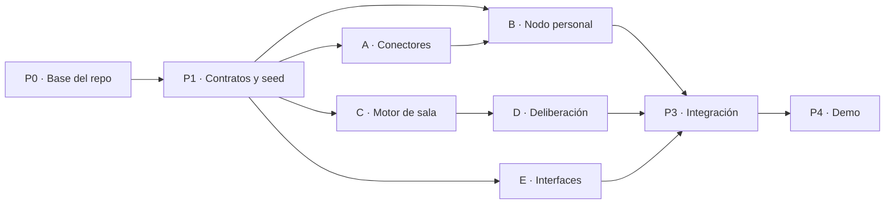

# Plan de construcción

*Plan paso a paso para construir la arquitectura por capas en el hack — base del repo, contratos y seed, cinco frentes en paralelo (conectores, nodo personal, motor de sala, deliberación, interfaces), integración, demo y qué cortar si falta tiempo.*

Pasos para construir [arquitectura-por-capas](arquitectura-por-capas.md). Está escrito para que otra sesión (persona o agente) lo tome sin el contexto de la conversación en que se diseñó.

## Antes de empezar

- **Leer primero:**
  - [arquitectura-por-capas](arquitectura-por-capas.md): contratos, algoritmos y decisiones.
  - `stack-por-defecto`: Next.js, Supabase, Vercel, Claude, y el espejo del repo para desplegar.
  - [mcp-ingestion](archivo/mcp-ingestion.md): solo para A5.
- **Documento vivo:** el `CLAUDE.md` del repo, con las decisiones en [decisiones](decisiones.md). Las decisiones nuevas van ahí, y los contratos en `src/lib/types.ts`. Si una decisión cambia este plan, actualizarlo también.
- **Supuestos:** lo marcado **Propuesta** en la arquitectura vale como supuesto para construir. Si un paso obliga a cambiarlo, preguntarle al equipo.
- **Plazo:** el repo cierra el **dom 22 · 09:30** (`cronograma`).

## Ruta crítica

P0 y P1 bloquean todo lo demás. Una vez listo P1, los frentes A, B, C y E avanzan en paralelo, uno por persona. D parte apenas C entregue mesas candidatas; antes puede avanzar con mesas escritas a mano en el seed.

## P0 · Base del repo

- Next.js (App Router), Tailwind y shadcn/ui, instalable como PWA (manifest).
- Supabase con las tablas `rooms`, `room_members` (proyección pública en `jsonb`), `mesas`, `group_nodes` y `deliberation_messages`, y Realtime activado en las tres últimas.
- Variables de entorno: `ANTHROPIC_API_KEY` y `SPOTIFY_CLIENT_ID` (el modelo de embeddings es local y no usa clave). Sin secretos en el repo, que es público.
- Deploy en Vercel desde el espejo personal del repo.

**Listo cuando:** la URL desplegada abre en un teléfono y lee y escribe en Supabase.

## P1 · Contratos y seed

- `types.ts` con los tipos de [arquitectura-por-capas § Contratos](arquitectura-por-capas.md#contratos) y sus esquemas `zod`.
- **Seed de sala:** 15 a 20 proyecciones públicas sintéticas, con los embeddings precalculados. Tiene que incluir:
  - el caso Ana, Bruno y Carla (montaña) del maestro;
  - un tema de pura afinidad (3 o más personas que solo *comparten*);
  - un tema con 3 expertos y ningún aprendiz;
  - una persona sin calce obvio, para probar la regla de nadie solo;
  - una **sala de control** aparte, sin nada en común, que debería dar 0 mesas.
- Modelo de embeddings: **decidido el 21-11**, `paraphrase-multilingual-MiniLM-L12-v2` local con transformers.js, quitando tildes antes de calcular. Con `gte-small` y multilingual-e5, el umbral 0,60 juntaba todo (ver `CLAUDE.md` · Decisiones).

**Listo cuando:** un solo comando carga la sala de seed en Supabase.

## Frente A · Conectores

Cada conector devuelve `Signal[]` validado con `zod`. Van en orden de valor sobre esfuerzo.

| Paso | Qué | Listo cuando |
|---|---|---|
| **A1** | Prompt para copiar y pegar en Claude, ChatGPT o Gemini, que devuelve JSON de `Signal[]`, más una pantalla para pegarlo. Es el **respaldo del demo**. | Un integrante pega la respuesta de ChatGPT y ve sus señales. |
| **A2** | GitHub: usuario → repos, lenguajes y temas → señales `sabe`. | Funciona con el usuario de un integrante. |
| **A3** | Spotify: OAuth PKCE → top artists y podcasts guardados → `le_gusta`. Registrar la app en modo desarrollo y agregar los emails del equipo. Confirmar qué endpoints siguen abiertos. | Login real y señales de un integrante. |
| **A4** | Instagram: subir el `.zip` del export JSON y leerlo en el cliente (seguidos, intereses inferidos). **Pedir los exports del equipo ahora**, porque tardan. | Señales con el export de un integrante. |
| **A5** | MCP `submit_profile` según [mcp-ingestion](archivo/mcp-ingestion.md), como buzón efímero y con token de desarrollo. | Claude llama la herramienta y el teléfono retira el perfil. |

## Frente B · Nodo personal

| Paso | Qué | Listo cuando |
|---|---|---|
| **B1** | Ruta `/api/synthesize`: `Signal[]` → `Topic[]` con salida estructurada, más las reglas deterministas de la arquitectura (topes de profundidad, corroboración, lista de exclusión de datos sensibles, `sources`). | Test: Spotify solo nunca da profundidad 3; un tópico de lista de exclusión nunca sale. |
| **B2** | Guardar el nodo en IndexedDB con versión. Resincronizar una fuente reemplaza solo sus señales y conserva las ediciones manuales. | Resincronizar Spotify no borra una profundidad editada a mano. |
| **B3** | Pantalla "Mi nodo": tópicos con el ícono de su fuente, profundidad editable, marca de público. | Se puede editar y publicar. |
| **B4** | Check-in: calcular los embeddings de los tópicos públicos y subir la `PublicProjection` a `room_members`. | Tres integrantes aparecen en la sala con sus proyecciones. |

## Frente C · Motor de sala

Funciones puras, sin LLM, probadas contra el seed. Es el frente más fácil de testear: conviene hacerlo con TDD.

| Paso | Qué |
|---|---|
| **C1** | Temas: clustering con umbral 0,60 y orden determinista. |
| **C2** | Roles por tema según la tabla de la arquitectura. |
| **C3** | Mesas candidatas: semillas, crecimiento greedy y puntaje. |
| **C4** | Asignación con capacidad, más la regla de nadie solo. |
| **C5** | Disparadores: check-in, salida y recálculo cada 5 minutos. Escribe en `mesas`. |

**Listo cuando** pasan estos tests:

- Del seed sale la mesa Ana, Bruno y Carla.
- La sala de control da 0 mesas (control negativo: los agentes no inventan afinidad).
- El mismo input en otro orden da las mismas mesas.
- Nadie queda en más de 2 mesas.
- Nadie queda sin mesa si existe una abierta (la persona sin calce obvio del seed).
- El tema con 3 expertos y ningún aprendiz no da mesa de complemento; el tema de pura afinidad da una mesa de afinidad.

Las expectativas concretas del seed están en `CLAUDE.md` (tests del motor).

## Frente D · Deliberación

| Paso | Qué |
|---|---|
| **D1** | Prompt y esquema del facilitador (`claude-sonnet-5-5`). |
| **D2** | Prompt y esquema del agente de miembro (`claude-haiku-5-5`), con la intención de hoy. El motivo de su respuesta no repite la intención textual. |
| **D3** | Verificador determinista de citas y roles. |
| **D4** | Orquestación: todas las mesas en paralelo, una revisión como máximo, cada mensaje se escribe en `deliberation_messages`. |

**Listo cuando:**

- Con el seed, cada mesa termina con un plan verificado o queda descartada.
- Un plan con una cita inventada se descarta.
- Se registran la latencia y el costo de una sala completa, para responder cómo escala.

## Frente E · Interfaces

| Paso | Qué |
|---|---|
| **E1** | Teléfono: Fuentes → Mi nodo → Check-in (QR) → Intención de hoy → **Mi mesa** (rol, plan, punto de encuentro, aceptar o rechazar). |
| **E2** | **Pantalla de sala** para el proyector: grafo de fuerzas con los temas como centros, las personas y las mesas como burbujas, más un panel con los mensajes entre agentes en vivo. |

**Listo cuando:** aceptar una mesa en el teléfono la activa en la pantalla de sala, vía Realtime y sin recargar.

## P3 · Integración

La sala de seed más 3 integrantes reales hacen el flujo completo, de las fuentes a la mesa aceptada. Corregir lo que se rompa entre frentes.

## P4 · Demo

- **Cachear el camino feliz:** dejar guardadas las respuestas de deliberación del seed, para no depender de la latencia en vivo.
- **Evidencia de que los agentes aportan:** las mesas que salen con solo embeddings (coincidencias) al lado de las que salen con roles y agentes. La diferencia tiene que verse.
- **Control negativo visible:** la sala sin nada en común da 0 mesas.
- Grabar un video de respaldo.
- Pitch con `guion-pitch` y `pitch-y-demo`.

## Si falta tiempo

Cortar en este orden:

1. **A5 · MCP:** queda el prompt de A1.
2. **A4 · Instagram:** queda como tarjeta "próximamente".
3. **Revisión de la deliberación (D4):** el plan se aprueba o se rechaza en una sola vuelta.
4. **Recálculo cada 5 minutos (C5):** se recalcula solo en el check-in.

No cortar: el seed (P1), el motor de sala (C), el verificador (D3) y la pantalla de sala (E2). Son el corazón del demo y de la evaluación.

## Preguntas abiertas

- ¿Cuál es hoy el tope de usuarios de Spotify en modo desarrollo y qué endpoints siguen abiertos? Se confirma en A3.
- ¿La intención de hoy es privada (la ve solo tu agente)? En la arquitectura es **Propuesta** y el guion de demo de `CLAUDE.md` ya la asume. Hay que confirmarlo con el equipo. Si es pública, D2 sobra. Dónde se guarda: ver I1 en [infra-propuestas](infra-propuestas.md).
- ¿Cómo se traduce el punto de encuentro a un lugar físico en el MUT? ¿Mesas numeradas o zonas?
