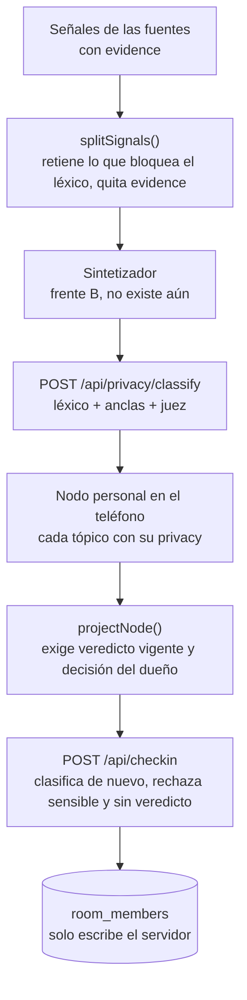

# Revisión: filtro de privacidad

*Guía para quien revisa este cambio. El diseño y la taxonomía están en [onboarding-privacidad](onboarding-privacidad.md); esta nota dice qué mirar, en qué orden, cómo comprobarlo y qué decisiones conviene cuestionar.*

**Estado:** 21-11. Cubre `src/lib/privacy/`, las rutas `/api/checkin` y `/api/privacy/classify`, la migración `20261121200000_checkin_by_server.sql` y los cambios de contrato en `src/lib/types.ts`.

## Qué resuelve

Lo que Claude, ChatGPT y las demás fuentes saben de una persona incluye salud, plata, trabajo y familia. Nada de eso puede llegar a una sala, que se muestra en un proyector con el nombre de cada uno. Antes de este cambio no había filtro, y además cualquiera con la clave publicable (va en cada teléfono) podía escribir una proyección directo en `room_members`.

La regla que el código tiene que cumplir: **un tópico llega a una sala solo si pasó el filtro en el teléfono y otra vez en el servidor; si una verificación falla o no responde, el tópico no entra.**

## Cómo fluye



Cada tópico recibe un nivel: `segura` (se puede recomendar), `personal` (el dueño decide, con un toque explícito) o `sensible` (nunca entra a una sala). Lo dan tres capas y gana la más estricta:

| Capa | Dónde | Qué aporta | Qué no puede hacer |
|---|---|---|---|
| Léxico y patrones | `screen.ts` | Determinista y testeable. Bloquea datos de contacto y términos por categoría | Atrapar lo dicho con otras palabras: marca 4 de 35 casos difíciles |
| Anclas por embedding | `anchors.ts` | Alerta local sin costo; marca la mitad de los sensibles sutiles | Bloquear: solo sube a `personal` |
| Juez LLM (`claude-haiku-5-5`, o `claude-opus-5-5` con `PRIVACY_JUDGE_MODEL=opus`) | `judge.ts`, `judge-model.ts` | La precisión: 0 fugas en 110 casos delicados | Bajar un nivel que puso otra capa |

## Orden de lectura

Unas 850 líneas de código, 460 de tests y una lista de prueba de 185 casos. En este orden cada archivo se apoya en los anteriores.

| # | Archivo | Qué mirar |
|---|---|---|
| 1 | `src/lib/types.ts` | `TopicPrivacySchema`, `privacy` opcional en `Topic`, `PublicTopicSchema` como lista blanca estricta, `SynthesisSignalSchema` |
| 2 | `src/lib/privacy/taxonomy.ts` | Niveles, categorías, `strictest()` y `fingerprint()`: el veredicto vale para un `kind` y un `name` exactos |
| 3 | `src/lib/privacy/screen.ts` | El léxico. `always` bloquea con cualquier `kind`; `unlessExpertise` deja pasar `sabe` y `ofrece` |
| 4 | `src/lib/privacy/anchors.ts` | Las frases ancla y el umbral 0,66 |
| 5 | `src/lib/privacy/judge.ts` | El prompt, el esquema de salida y qué pasa cuando el modelo falla o responde mal |
| 6 | `src/lib/privacy/classify.ts` | `classifyTopics()` junta las capas; `createCachedClassifier()` fija el veredicto por tópico |
| 7 | `src/lib/privacy/projection.ts` | `projectNode()`: las cinco razones por las que un tópico no sale del teléfono |
| 8 | `src/lib/privacy/checkin.ts` y `src/app/api/checkin/route.ts` | El servidor no cree nada de lo que manda el teléfono |
| 9 | `supabase/migrations/20261121200000_checkin_by_server.sql` | Quita las dos políticas que permitían escribir sin filtro |
| 10 | `src/lib/privacy/canary.test.ts` | El peor caso, de punta a punta |
| 11 | `scripts/add-person.mts` | `pnpm seed:person` ahora filtra antes de escribir en el repo |

## Cómo verificarlo

```bash
pnpm test            # 233 tests; los del filtro están en src/lib/privacy/
pnpm privacy:eval    # precisión y latencia; con ANTHROPIC_API_KEY en .env.local mide el juez
PRIVACY_JUDGE_MODEL=opus pnpm privacy:eval    # lo mismo con Opus 5.5
```

`pnpm privacy:eval` sale con error si algún caso delicado queda como `segura` o si el juez no respondió. Resultado del 21-11, tres corridas por modelo:

| Qué | Haiku 5.5 | Opus 5.5 |
|---|---|---|
| Delicados clasificados como seguros (de 110) | 0 | 0 |
| Sensibles que quedan `sensible` (de 91) | 88 a 90; el resto en `personal` | 91 |
| Seguros cercanos a una categoría que quedan `segura` (de 75) | 70 a 71 | 72 |
| Tópicos del seed que quedan `segura` (de 132) | 129 | 130 |
| Latencia de un perfil real de 46 tópicos | 1,7 a 2,0 s | 2,3 a 2,8 s |

Haiku no es determinista: entre corridas 1 a 3 casos cambian entre `sensible` y `personal`. Opus dio lo mismo las tres veces. En ninguna corrida de ningún modelo un caso delicado quedó `segura`.

Para probar el check-in a mano, con Supabase local arriba y las claves en `.env.local`:

```bash
pnpm dev
curl -X POST localhost:3000/api/checkin -H 'Content-Type: application/json' -d '{
  "roomCode": "HACK26", "personId": "prueba", "displayName": "Prueba",
  "topics": [
    {"id": "p.jazz", "name": "jazz", "kind": "le_gusta", "depth": 2, "sources": ["chatgpt"]},
    {"id": "p.sertralina", "name": "sertralina todas las mañanas", "kind": "hace", "depth": 1, "sources": ["chatgpt"]}
  ]}'
```

Debe aceptar `p.jazz` y rechazar `p.sertralina` con `reason: "sensible"`. Ese tópico no está en el léxico: lo rechaza el juez en el servidor. Agregar un campo cualquiera a un tópico debe dar 400.

## Decisiones que conviene cuestionar

1. **Falla cerrado en el servidor.** Si el juez no responde y no hay veredicto guardado, el check-in rechaza el tópico (`sin_revisar`). Con la API de Anthropic caída durante el demo, quien no haya pasado antes por el onboarding entra sin tópicos. La alternativa es admitir lo que pasa el léxico, que deja pasar 31 de los 35 casos difíciles.
2. **El servidor admite `personal`.** Publicarlo es decisión del dueño, y el toque explícito solo se exige en el teléfono (`decidedBy: "user"` en `projectNode()`). Un cliente con un bug podría publicar un tópico `personal` que nadie aprobó.
3. **El caché de veredictos vive en memoria.** Se pierde al reiniciar y no se comparte entre instancias. Alcanza porque Render corre un solo proceso; con más de uno habría que moverlo a una tabla, que guardaría nombres de tópicos sin persona asociada.
4. **Las anclas no bloquean.** El doc original las proponía como bloqueo en el check-in. MiniLM no separa vivir un tema de saberlo ("psiquiatra" como oficio da 0,85 contra "sesiones con mi psiquiatra"), y como un nivel nunca baja, el juez no podría corregirlo.
5. **El motivo es una plantilla, no texto del modelo.** Era la mitad de los tokens de salida y por tanto de la latencia. Se pierde la explicación específica de cada tópico.
6. **El léxico prefiere precisión.** Dejé fuera términos ambiguos ("demanda", "custodia", "raza", "embargo") para no bloquear "generación de demanda" o "custodia de criptoactivos". Cada término que se agregue necesita un caso en `eval-set.ts`, porque lo que el léxico bloquea nadie lo puede desbloquear.
7. **Lista de prueba escrita por la misma persona que el filtro.** Los 185 casos de `eval-set.ts` los escribí yo. Los ejemplos del prompt no se repiten en la lista, pero un revisor que agregue casos propios es la mejor prueba que le falta.

## Límites conocidos

- **Inferencia por conjunto.** Varios tópicos seguros pueden delatar algo juntos. Nada lo cubre; es el auditor (V5) de [onboarding-privacidad](onboarding-privacidad.md).
- **Texto de la deliberación.** Plan, cita, punto de encuentro y motivo todavía no pasan por ningún filtro, porque el frente D no existe. `screenText()` está listo para eso.
- **El proveedor ve los nombres de los tópicos.** El juez recibe `kind`, `name` y `sources`, nunca `evidence` ni el nombre de la persona. Lo que bloquea el léxico no se envía.
- **Rutas abiertas.** `/api/checkin` y `/api/privacy/classify` no piden autenticación y llaman a un modelo: están acotadas a 60 tópicos de 80 caracteres por llamada, sin límite de frecuencia.
- **Salir de la sala** sigue con una política abierta (`"leave room"`): cualquiera puede borrar la fila de otro. No expone datos, pero permite sacar a alguien.

## Al mergear

1. Aplicar la migración en Supabase local (`pnpm exec supabase migration up`) y en la nube. Sin ella el filtro del servidor se puede saltar con un insert directo.
2. Confirmar que `ANTHROPIC_API_KEY` está definida en Render: `render.yaml` ya la declara. Sin ella el check-in rechaza todo tópico que no bloquee el léxico.
3. Para usar Opus, definir `PRIVACY_JUDGE_MODEL=opus` en el panel de Render. Sin la variable corre Haiku. El log de arranque dice cuál quedó: `[privacy] juez: claude-opus-5-5`.
4. El teléfono (frente E) tiene que hacer check-in con `POST /api/checkin` y no con un insert a `room_members`; ya no necesita llamar a `/api/embed` para eso.
