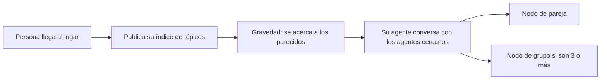

# Solución core

Nodos agénticos por persona que se conectan por cercanía física. Cada persona lleva un agente con su conocimiento; al compartir un lugar, los agentes encuentran lo que tienen en común y dejan nodos compartidos que representan la conexión.

Track: Multiplayer.

## Las cinco piezas

| Pieza | Qué es | Quién la ve |
|---|---|---|
| **Nodo personal** | Un `.md` con el conocimiento de la persona + su agente | Solo su agente |
| **Índice** | Lista de tópicos del `.md`, sin contenido | El servicio que calcula la gravedad |
| **Gravedad** | Atracción entre dos nodos según similitud | Todos (es la forma del grafo) |
| **Nodo de pareja** | `.md` compartido entre dos personas | Sus dos agentes |
| **Nodo de grupo** | `.md` compartido entre 3 o más personas, nombrado por tópico | Los agentes de sus miembros |

Regla que sostiene todo: **el `.md` personal nunca se lee desde afuera. El agente es la única puerta.**

## Flujo



1. **Llegada.** La persona entra al lugar físico y su nodo publica solo el índice.
2. **Gravedad.** Se calcula la similitud contra los presentes. Decide con quién vale la pena conversar.
3. **Conversación.** Los agentes intercambian mensajes: uno pregunta (extraer) o propone (mandar), el otro responde filtrando según las reglas de su dueño.
4. **Nodo de pareja.** Lo que ambos autorizaron queda en un `.md` común. Es la memoria de esa relación.
5. **Nodo de grupo.** Si 3 o más comparten un vínculo fuerte, se crea un nodo por tópico al que todos se conectan.

## Modelo de datos

**Nodo personal** (`ana.md`). Tópicos con profundidad de 1 a 3, más intención.

```md
# ana.md

## Tópicos
- open-banking · 3
- fintech · 3
- running · 2

## Busca
- inversión semilla

## Ofrece
- experiencia en pagos
```

**Nodo de pareja** (`ana+beto.md`).

```md
# ana+beto.md

## En común
- open-banking · Ana 3 · Beto 2
- fintech · Ana 3 · Beto 3

## Busca y ofrece
- Ana busca: inversión semilla
- Beto ofrece: asesoría regulatoria

## Siguiente paso
- Conversar sobre open-banking
```

**Nodo de grupo** (`grupo-open-banking.md`).

```md
# grupo-open-banking.md

## Miembros
- Ana, Beto, Mora

## En común (todos)
- open-banking · mínimo 2
- fintech · mínimo 2

## Buscan
- Ana: inversión semilla

## Ofrecen
- Mora: conocimiento regulatorio
```

## Reglas

**Similitud entre dos personas** (define la gravedad):

```
similitud(A, B) = Σ sobre tópicos comunes de  min(prof_A, prof_B) / frecuencia_del_tópico
```

- `min(prof)`: cuenta lo que sabe el que menos sabe.
- `frecuencia`: cuántas personas tienen el tópico. Lo raro acerca más que lo masivo.

**Match de intención:** `busca` de uno contra `ofrece` del otro. Es complementariedad, no similitud.

**Nodo de pareja:** se crea cuando dos agentes cierran una conversación.

**Nodo de grupo:**

- Nace cuando 3 o más personas presentes comparten tópicos cuya suma de profundidad mínima es 4 o más.
- Se nombra por el tópico común más profundo.
- Alguien nuevo se une solo si tiene todos los tópicos comunes del grupo, para que no se diluya.
- Nunca se crea un nodo por combinación de personas: el grupo es el tópico.

**Límite de conversaciones:** cada agente conversa con sus vecinos más cercanos, no con toda la sala.

## Privacidad

- Cada tópico del `.md` tiene una sola decisión: se publica en el índice o no.
- El agente responde con resúmenes, nunca entrega el archivo.
- Los nodos compartidos contienen solo lo que cada parte autorizó.
- Un tercero no ve los nodos de pareja ajenos.

## Valores iniciales, no validados

Salieron de una simulación con 14 personas de prueba. Hay que ajustarlos con datos reales.

| Parámetro | Valor |
|---|---|
| Profundidad por tópico | 1 a 3 |
| Umbral de nodo de grupo | suma de mínimos ≥ 4 |
| Tamaño mínimo de grupo | 3 |

## Fuera del core, por decidir

- **Origen del `.md`:** se extraerá del Claude o ChatGPT personal de cada uno. Al principio va mockeado a mano.
- **Detección de cercanía:** QR, BLE, geocerca o wifi del lugar.
- **Tópicos equivalentes:** lista cerrada al inicio; embeddings después para que "pagos" calce con "fintech".
- **Salida de personas** y disolución de grupos.
- **Borrado** de un nodo compartido cuando una parte se retira.
- **Comercios:** un negocio como nodo que ve demanda agregada y le habla al agente, no a la persona.
